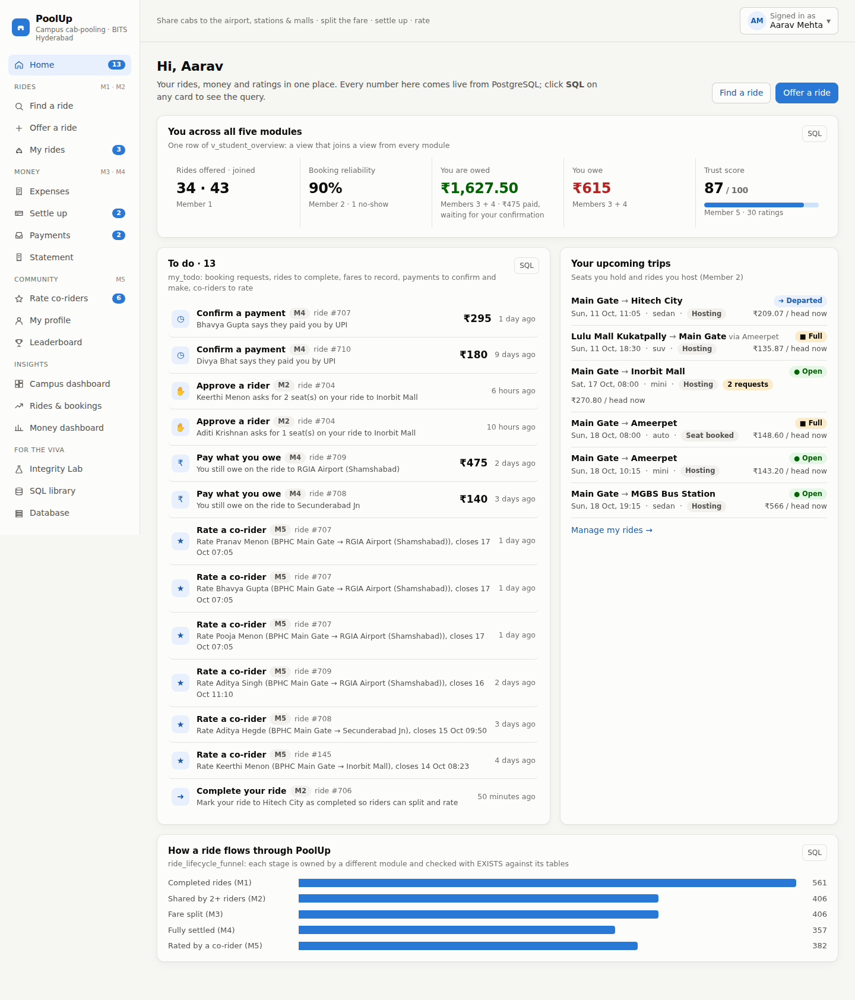
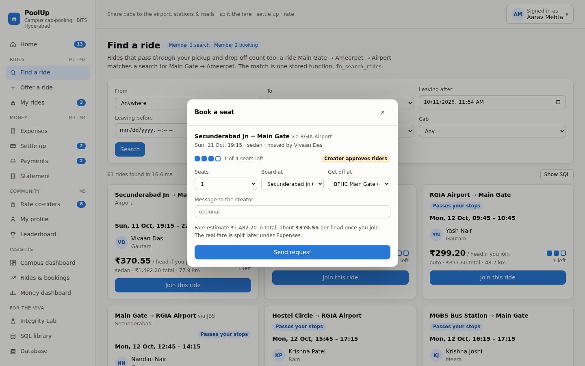
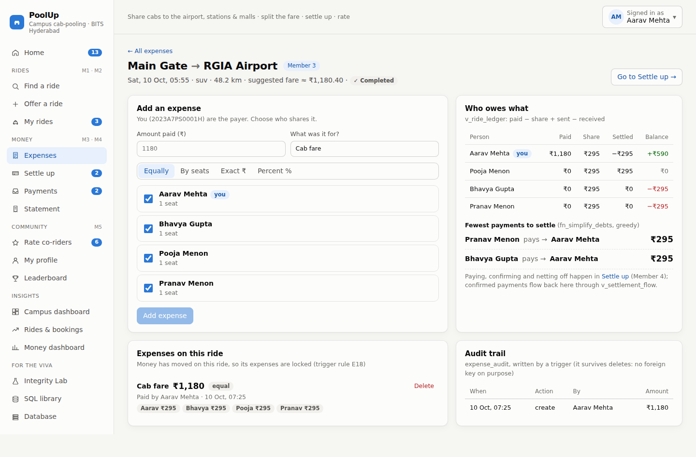
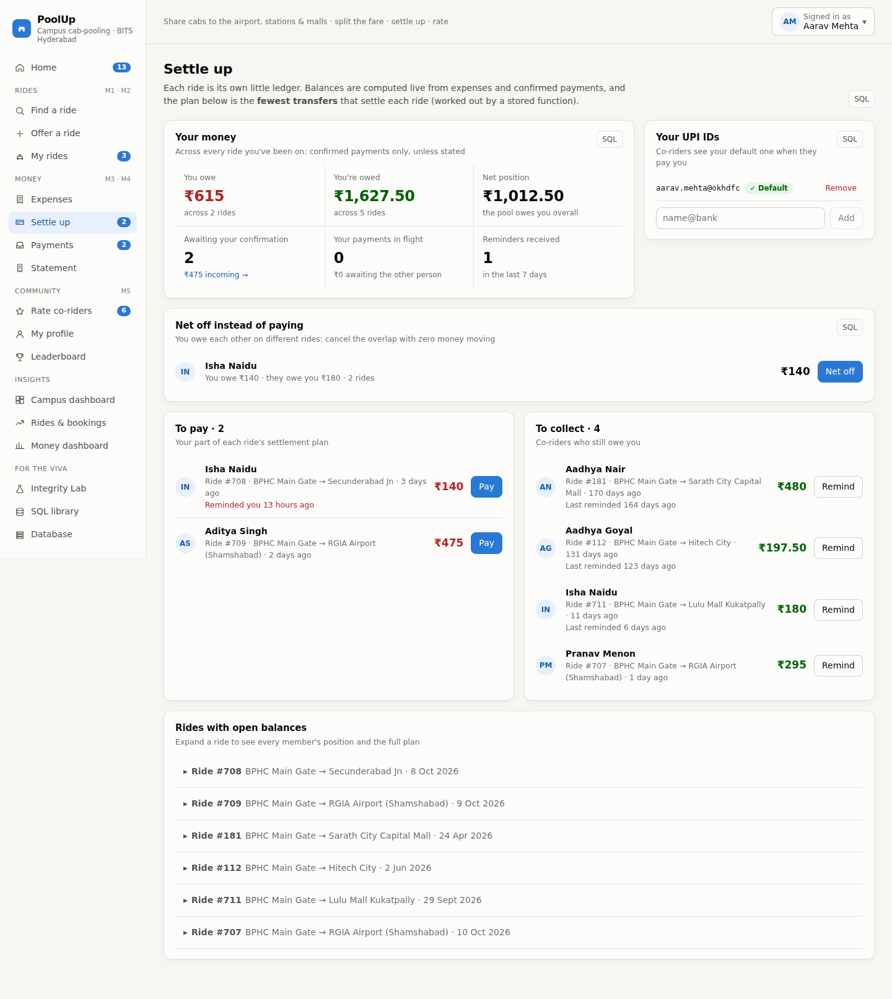
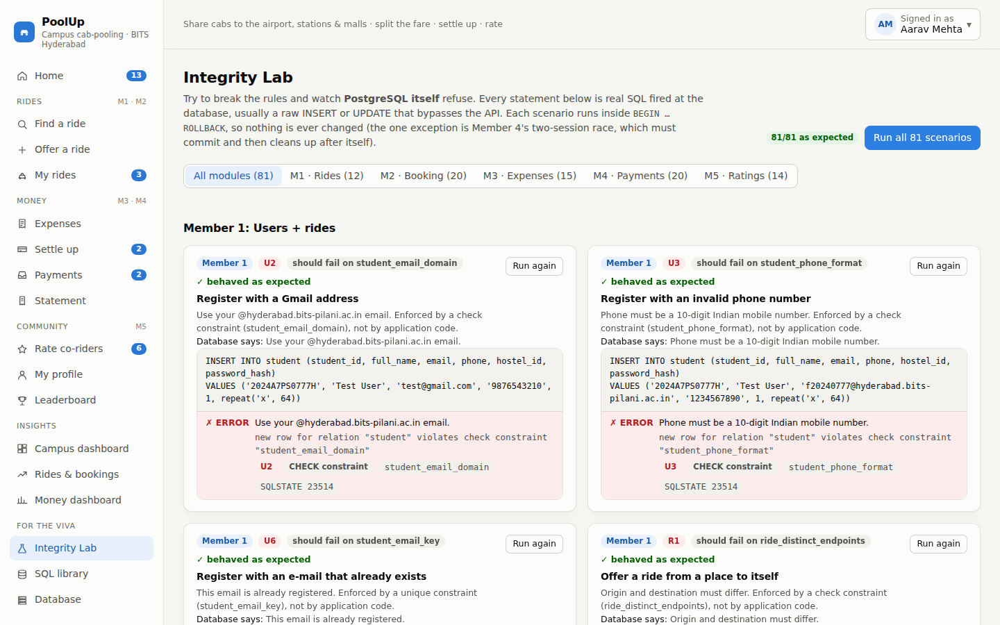
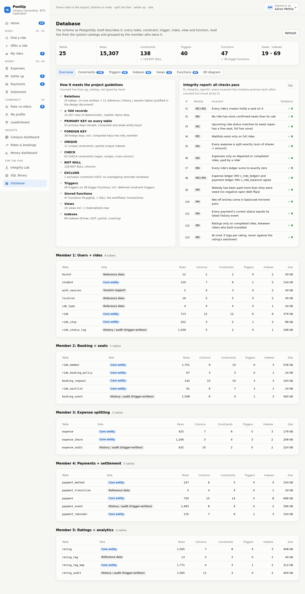
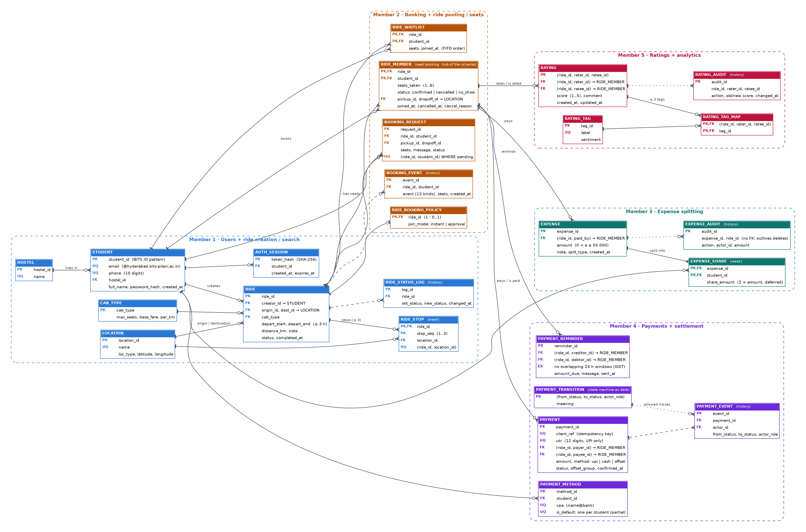

# PoolUp: campus cab-pooling with Splitwise-style splitting

> **DBMS course project · BITS Pilani, Hyderabad Campus**
> BPHC students share cabs to RGIA airport, Secunderabad and Kacheguda stations, bus stands and malls. PoolUp lets them **offer and find rides** (including rides that pass through their stop), **book seats** (instantly, by approval or on a fair waitlist), **split the fare** to the paisa, **settle up** by UPI or cash without ever paying twice, and **rate co-riders**. It is a full-stack application, **React → Express REST API → PostgreSQL 16**, in which **every business rule is enforced by the database**: constraints, triggers and stored functions decide, and the app shows which mechanism refused a request and why.

| 25 tables | 15,300+ seeded rows | 138 constraints + 128 NOT NULL | 40 triggers | 47 functions | 19 views | 69 indexes | 84 named queries | 81 Integrity Lab scenarios | 63 end-to-end tests |
|---|---|---|---|---|---|---|---|---|---|

## Team

| Member | Name | BITS ID | Module |
|---|---|---|---|
| Member 1 | *Member 1 name* | *20XXXXXXXXXXH* | Users + ride creation / search |
| Member 2 | *Member 2 name* | *20XXXXXXXXXXH* | Booking + ride pooling / seat management |
| Member 3 | *Member 3 name* | *20XXXXXXXXXXH* | Expense splitting |
| Member 4 | *Member 4 name* | *20XXXXXXXXXXH* | Payments + settlement |
| Member 5 | Aditya Kumar | *20XXXXXXXXXXH* | Ratings + analytics / dashboard |

(The same names go in `docs/team.json`; `python3 docs/design/build_pdf.py` then rebuilds the PDFs with them.)

## Screenshots

| Home: everything waiting for you, from all five modules | Find a ride and book a seat |
|---|---|
|  |  |
| **Split a fare (shares always add up to the paisa)** | **Settle up: balances, fewest-transfer plan, net-off** |
|  |  |
| **Integrity Lab: 81 / 81 rules refuse raw SQL** | **Database: the schema explained by PostgreSQL itself** |
|  |  |

More in [`docs/screenshots/`](docs/screenshots) (dark mode and phone width included).

## What each module does

| Module | Highlights |
|---|---|
| **M1 Users + rides** | Register / log in (BITS-ID and campus-email CHECKs, scrypt password hashes, SHA-256 session tokens); offer a ride with up to 3 stops, atomically with the creator's seat (`fn_create_ride`); search that also matches rides *passing through* your stops (`fn_search_rides`); fare estimates from coordinates; ride state machine with a trigger-written history; "no overlapping rides" under a row lock |
| **M2 Booking + seats** | Book 1–6 seats with a pickup / drop-off on the route; capacity enforced by a trigger that locks the ride row (6 people racing for 2 seats → exactly 2 win); instant or approval mode (one pending request per ride: partial unique index); FIFO first-fit waitlist with automatic promotion; cancel, remove, no-show, start, complete; append-only booking feed |
| **M3 Expense splitting** | Equal / by seats / exact / percent splits computed in the database with largest-remainder rounding in paise; Σ shares = amount checked at COMMIT by a deferred constraint trigger; immutable expenses with a trigger-written audit trail; per-ride ledger, pairwise "who owes whom", fewest-payments plan |
| **M4 Payments + settlement** | Every ride is a group ledger, balances derived (never stored); pay by UPI (QR code + 12-digit UTR) or cash, idempotently; overpayment impossible even under concurrency; payment state machine stored as data; net-off of mutual debts across rides checked at COMMIT; rate-limited reminders (EXCLUDE constraint); statement with a running balance; money dashboard |
| **M5 Ratings + analytics** | Rate all co-riders in one transaction (1–5★, ≤ 3 tags, a comment for 1–2★, 7-day window, 24 h edits, audit); Bayesian trust score, leaderboard on a materialized view, trust network with a recursive CTE; campus dashboard (₹ saved, trends, demand heatmap, routes, occupancy, rating analytics) |
| **Cross-module** | Home to-do (`my_todo`), student 360 view, ride lifecycle funnel, "do trusted riders pay faster?", ledger agreement between M3 and M4, `fn_integrity_report()` with 13 live invariants, Database page built from the system catalogs |

## How it meets the project guidelines

| Requirement | Where |
|---|---|
| Problem statement, ER / EER, schema, constraints, assumptions, normalization, design decisions (≤ 5 pages) | [`docs/PoolUp_Design_Document.pdf`](docs/PoolUp_Design_Document.pdf) (source: `docs/design/DESIGN.md`) |
| 8–12 meaningful relations; a larger count justified | 25 relations: 14 core entities / relationships + 5 reference + 5 trigger-written history + 1 session table; justification in §2 of the design document |
| ≥ 500 records | ~15,300 deterministic rows in 25 tables (`npm run db:setup` prints the count per table) |
| PK, FK, UNIQUE, NOT NULL, CHECK enforced in the DBMS | 25 PK, 38 FK (many composite), 11 UNIQUE (2 partial), 63 CHECK, 128 NOT NULL, 1 EXCLUDE: all listed live on the **Database** page |
| ≥ 3 DBMS features | Transactions (every workflow is one stored function), 40 triggers incl. deferred constraint triggers, 47 stored functions, 19 views incl. a materialized view, 69 indexes (B-tree, GiST, partial, covering), row-level locking, recursive CTEs, window functions |
| ≥ 5 non-trivial SQL queries | 84 named queries in [`db/queries/`](db/queries), browsable with EXPLAIN ANALYZE in the **SQL library**; 15 picked out as the "viva showcase" |
| ≥ 3 end-to-end workflows | Transaction, reporting and integrity workflows below |
| Front end ↔ back end ↔ RDBMS | React 18 + Vite → Express 5 REST API with raw parameterised SQL (no ORM) → PostgreSQL 16 |
| Reproducible | One command builds and seeds the database; `npm test` rebuilds a separate test database for every test file |

## Tech stack

| Layer | Choice |
|---|---|
| Database | **PostgreSQL 16** (+ `btree_gist` for the EXCLUDE constraint): PL/pgSQL triggers and functions, deferred constraints, recursive CTEs, window functions, materialized view |
| Back end | **Node.js 18+ / Express 5**, `pg`, **raw parameterised SQL, no ORM**; one error translator maps every constraint / trigger to its business rule (123 rules) |
| Front end | **React 18 + Vite**, React Router, Recharts, `qrcode`; light and dark themes; works at phone width |
| Tests | `node:test` + `supertest` against the real API and a real database |

## Setup and run

**Prerequisites:** Node.js ≥ 18 and PostgreSQL ≥ 14 with the standard contrib extensions (they include `btree_gist`). No local PostgreSQL? `docker compose up -d` starts one matching the defaults.

```bash
# 1. database + API
cd server
cp .env.example .env          # edit DATABASE_URL if your postgres user / password differ
npm install
npm run db:setup              # creates DB "poolup", runs db/*.sql in order, seeds ~15,300 rows,
                              # then prints "All 13 cross-module integrity checks pass"
npm run dev                   # API on http://localhost:4000

# 2. front end (second terminal)
cd client
npm install
npm run dev                   # UI on http://localhost:5173 (proxies /api to :4000)
```

**Single-process demo mode:** `cd client && npm run build`, then `cd ../server && npm start` and open **http://localhost:4000**.

**Log in** as the demo student **Aarav Mehta: `2023A7PS0001H` / `poolup123`** (the login page has a button that fills it in). Every seeded student uses the same password, and the account menu (top right) switches to any of them, e.g. to confirm a payment as its payee.

**Tests:** `cd server && npm test` runs **63 end-to-end tests** (12 M1, 13 M2, 14 M3, 12 M4, 12 M5). Each test file rebuilds and seeds its own database `poolup_test`, so the demo database is never touched. They cover every rule in every module, the concurrency guarantees (simultaneous requests → exactly one winner), the cross-module ledger agreement and all 81 Integrity Lab scenarios.

> Run `npm run db:setup` again right before a demo. The data is generated relative to the moment of seeding, so there are always fresh rides to rate, payments to confirm, debts to pay, requests to approve and a departed ride to complete. The app shows a banner when the data is more than 4 days old.

**Optional UI check:** with the app running, `node scripts/ui-smoke.cjs http://localhost:4000 docs/screenshots light 1440` (needs Playwright) opens all 17 pages and fails on any console error, failed API call or horizontal overflow.

## The three major workflows

### 1. Transaction workflow: one ride through all five modules
1. **Offer a ride** (M1): `fn_create_ride` locks the creator's student row, inserts the ride, its stops and the creator's seat in one transaction; triggers refuse rides in the past, beyond 60 days, overlapping another ride, or stopping at their own endpoint.
2. **Book a seat** (M2): `fn_book_seat` locks the ride row; the capacity trigger re-counts confirmed seats; approval rides create a request, full rides offer the waitlist; a cancellation promotes the first waitlisted rider who fits.
3. **Start / complete** (M2): the ride state machine allows open/full → departed → completed only.
4. **Record the fare** (M3): `fn_add_expense` computes the shares with `fn_expense_shares` and inserts expense + shares; the deferred trigger checks Σ shares = amount at COMMIT.
5. **Settle up** (M4): `fn_record_payment` (idempotent on a client UUID) locks the ride and refuses overpayment, counting pending payments; the payee confirms through `fn_transition_payment`, allowed only by a row in `payment_transition`; or `fn_net_off` cancels mutual debts across two rides, verified at COMMIT.
6. **Rate co-riders** (M5): the whole batch is one transaction; one invalid rating rolls them all back.

### 2. Retrieval and reporting workflow
Home (`my_todo`: one query over six sources from five modules), **Campus dashboard**, **Rides & bookings**, **Money dashboard**, **Statement** (window running balance), **Leaderboard** (materialized view), **Profile** (trust network, recursive CTE). Every card has a **SQL** button with the exact query, its DBMS concepts, its bind parameters and an **EXPLAIN ANALYZE** plan with the indexes used. The **SQL library** lists all 84 queries.

### 3. Integrity-enforcement workflow
The **Integrity Lab** runs 81 scenarios (12 M1, 20 M2, 15 M3, 20 M4, 14 M5). Each fires real SQL, usually a raw INSERT / UPDATE that bypasses the API, inside `BEGIN … ROLLBACK`, and shows which mechanism refused it: CHECK, FK, PK / UNIQUE, partial unique index, EXCLUDE, trigger, deferred constraint trigger or stored function (incl. a real two-session payment race). The **Database** page runs `fn_integrity_report()`: 13 invariants the modules promise each other (no overbooked ride, every ledger sums to ₹0, M3 and M4 ledgers agree, …), all at 0.

## Database

```
db/
├── 00_reset.sql                       drop / create schema, extensions
├── 10–16  tables                      m1 users + rides · m2 booking · m3 expenses · m4 payments (+ state machine) · m5 ratings (+ tags)
├── 20–24  logic                       triggers + stored functions, one file per module
├── 30–34  views                       incl. the materialized view mv_student_reputation
├── 40–44  indexes                     each serves a named query or a trigger
├── 50_integration.sql                 v_student_overview, fn_integrity_report()
└── queries/                           84 named, parameterised, read-only queries (one file per module + cross-module)
```

`server/scripts/setup-db.js` runs every `db/NN_*.sql` in numeric order and then the seed pipeline (`server/scripts/seed/`): M1 users + rides → M2 bookings → M3 expenses → demo story → M4 payments → M5 ratings, all in one transaction. Seeding sets `poolup.seeding = 'on'`, which skips only the clock-based trigger rules (so historical rides can be loaded); every CHECK, FK, capacity and status rule still applies to every seeded row.



## Project structure

```
poolup/
├── README.md                     you are here
├── docker-compose.yml            optional local PostgreSQL 16
├── db/                           schema, constraints, triggers, functions, views, indexes, named queries
├── server/
│   ├── scripts/setup-db.js       one-command build + seed
│   ├── scripts/seed/             one generator per module + the demo story + shared traits
│   ├── src/routes/               auth · rides · students (M1) · bookings (M2) · expenses (M3) · payments (M4) · ratings · analytics (M5) · lab · database
│   ├── src/rules/                the business-rule catalogue of each module (constraint name → rule id, mechanism, text)
│   ├── src/lab/                  Integrity Lab scenarios of each module + the shared runner
│   └── test/                     63 end-to-end tests, one file per module
├── client/src/
│   ├── App.jsx                   app shell, login, navigation
│   ├── pages/                    Home · Find / Offer a ride · My rides · Expenses · Settle up · Payments · Statement ·
│   │                             Rate · Profile · Leaderboard · Campus / Rides & bookings / Money dashboards · Lab · SQL library · Database
│   └── components/               design system, charts, SQL drawer
├── scripts/ui-smoke.cjs          optional Playwright check of every page
└── docs/
    ├── PoolUp_Design_Document.pdf   final design document (5 pages)
    ├── PoolUp_Viva_Guide.pdf        15-minute team demo script + questions to expect
    ├── INTEGRATION_NOTES.md         every decision taken when the five modules were merged
    ├── design/                      design-document source, ER generator (er.py), PDF build script
    ├── modules/                     each member's own design and viva notes (+ original module PDFs)
    └── screenshots/
```

## Contributions

| Member | Contribution |
|---|---|
| Member 1 | Users and rides: `student`, `hostel`, `location`, `cab_type`, `ride`, `ride_stop`, `ride_status_log`, `auth_session`; login / registration with hashed passwords and session tokens; `fn_create_ride` (row lock against overlapping rides), `fn_search_rides` (via-stop matching), fare / distance functions, ride state machine and history triggers; ride board views, indexes, 11 named queries, Find / Offer a ride pages, 12 lab scenarios, 12 tests |
| Member 2 | Booking and seat management: `ride_member`, `ride_booking_policy`, `booking_request`, `ride_waitlist`, `booking_event`; capacity, overlap, segment and status-flow triggers (row locks), waitlist promotion, approval workflow, ride lifecycle cascade; occupancy / manifest / waitlist / reliability views, covering and partial indexes, 11 named queries, booking dialog and My rides pages, 20 lab scenarios, 13 tests incl. concurrency |
| Member 3 | Expense splitting: `expense`, `expense_share`, `expense_audit`; largest-remainder splitting (`fn_split_amount`, `fn_expense_shares`), atomic `fn_add_expense`, deferred Σ-shares constraint trigger, immutability, delete lock and audit triggers; ledger / pairwise-balance views, `fn_simplify_debts`, 7 named queries, Expenses pages, 15 lab scenarios, 14 tests |
| Member 4 | Payments and settlement: `payment`, `payment_method`, `payment_transition`, `payment_event`, `payment_reminder`; derived group ledger `v_ride_balance`, idempotent `fn_record_payment` with the overpayment row lock, state machine as data, `fn_settlement_plan`, `fn_net_off` with a deferred pair check, EXCLUDE-limited reminders, partial unique default UPI ID; 25 named queries, Settle up / Payments / Statement / Money dashboard pages, 20 lab scenarios incl. a two-session race, 12 tests |
| Member 5 | Ratings and analytics: `rating`, `rating_tag`, `rating_tag_map`, `rating_audit`; rating window / sentiment / max-tags / protection triggers, batch rating transaction, Bayesian trust score, materialized-view leaderboard, recursive trust network; campus dashboard, 23 named queries, 14 lab scenarios, 12 tests; **integration**: unified app shell and design system, Home, Database page, SQL library, cross-module queries and integrity report, combined documentation |

*Integration work (shared by the team): one schema and file order, one seed pipeline with a demo story, one login across all modules, one Integrity Lab, one SQL library, `fn_integrity_report()`, the cross-module queries, the design document and the viva guide. See [`docs/INTEGRATION_NOTES.md`](docs/INTEGRATION_NOTES.md).*

## Submitting on GitHub

```bash
git init && git add . && git commit -m "PoolUp: integrated DBMS course project"
git branch -M main
git remote add origin https://github.com/<your-team>/poolup.git
git push -u origin main
```
`node_modules/`, `client/dist/` and `.env` are already in `.gitignore`.

## Troubleshooting

| Symptom | Fix |
|---|---|
| `Setup failed: password authentication failed` | Set `DATABASE_URL` in `server/.env` to your PostgreSQL user and password |
| `extension "btree_gist" is not available` | Install your distribution's PostgreSQL contrib package (e.g. `postgresql-contrib`), or use `docker compose up -d` |
| The app shows "The demo data is N days old" | `cd server && npm run db:setup` |
| Port 4000 or 5173 is busy | `PORT=4001 npm run dev` (and change the proxy target in `client/vite.config.js`) |
