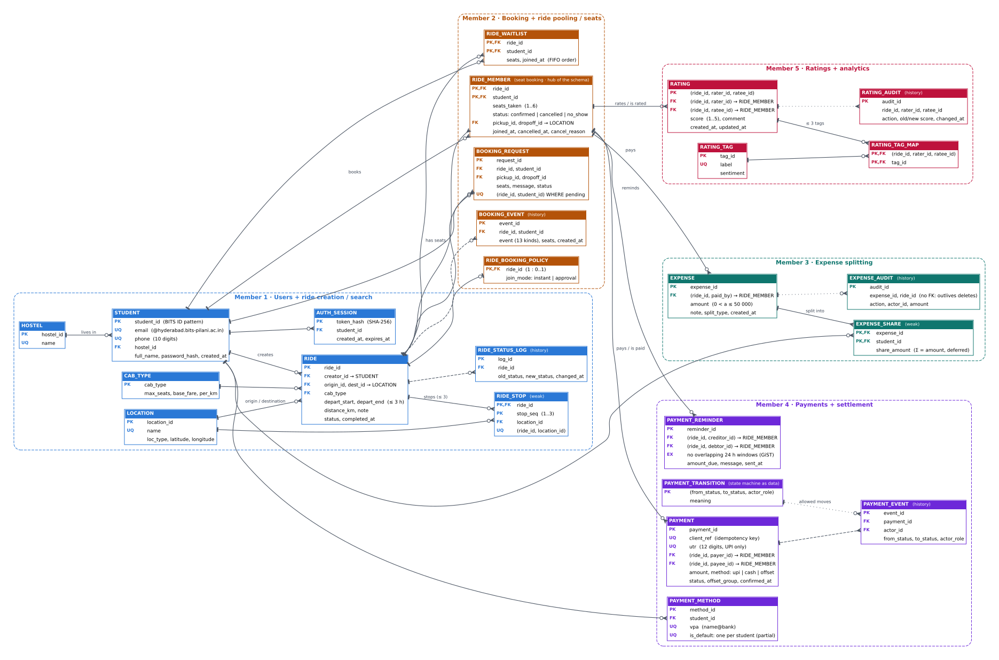

# PoolUp: Database Design Document

<table>
<thead><tr><th>Member</th><th>Module</th><th>Name</th><th>BITS ID</th></tr></thead>
<tbody>
<tr><td>Member 1</td><td>Users + ride creation / search</td><td>{{M1_NAME}}</td><td>{{M1_ID}}</td></tr>
<tr><td>Member 2</td><td>Booking + ride pooling / seat management</td><td>{{M2_NAME}}</td><td>{{M2_ID}}</td></tr>
<tr><td>Member 3</td><td>Expense splitting</td><td>{{M3_NAME}}</td><td>{{M3_ID}}</td></tr>
<tr><td>Member 4</td><td>Payments + settlement</td><td>{{M4_NAME}}</td><td>{{M4_ID}}</td></tr>
<tr><td>Member 5</td><td>Ratings + analytics / dashboard</td><td>{{M5_NAME}}</td><td>{{M5_ID}}</td></tr>
</tbody>
</table>

## 1. Problem and scope

BPHC students constantly travel to RGIA airport, Secunderabad / Kacheguda stations, bus stands and malls, and today they find co-riders through chat groups, split fares by hand and chase money for days. **PoolUp** is a full-stack application (React → Express REST API → PostgreSQL 16) in which a student can **offer or find a ride** (with intermediate stops), **book a seat** (instantly, by approval, or on a waitlist), **split the fare** Splitwise-style, **settle up** by UPI or cash, and **rate co-riders**. The design principle throughout is that **every business rule lives in the database**: constraints, triggers and stored functions enforce it, and the API only reports *which* mechanism refused a request. The database is rebuilt and seeded with one command (`npm run db:setup`, ~15,300 rows) and checked by 63 automated end-to-end tests, an 81-scenario Integrity Lab and 13 live cross-module invariants.

## 2. Relations and why there are 25

The guidelines suggest 8–12 relations and ask a larger count to be justified. PoolUp has five independently built modules; each owns 3–8 tables, and **14 of the 25 are core entities / relationships**. The other 11 are deliberately separate for normalization and auditability: 5 small **reference** tables (lookup values that would otherwise be repeated strings), 5 append-only **history** tables written only by triggers, and 1 session table.

| Role | Relations |
|---|---|
| Core entities and relationships (14) | `student`, `ride`, `ride_stop` (weak), `ride_member`, `ride_booking_policy`, `booking_request`, `ride_waitlist`, `expense`, `expense_share` (weak), `payment_method`, `payment`, `payment_reminder`, `rating`, `rating_tag_map` |
| Reference data (5) | `hostel`, `location`, `cab_type`, `rating_tag`, `payment_transition` (the payment state machine stored as rows) |
| History / audit, trigger-written (5) | `ride_status_log`, `booking_event`, `expense_audit`, `payment_event`, `rating_audit` |
| Session support (1) | `auth_session` (only a SHA-256 of each login token is stored) |

`ride_member (ride_id, student_id)` is the **hub** of the schema: an expense payer, both parties of a payment or reminder, and both parties of a rating are **composite foreign keys into it**, so "only people who were on this ride" is enforced declaratively in four modules.

## 3. Assumptions

1. Users are BPHC students identified by their BITS ID; e-mails are `@hyderabad.bits-pilani.ac.in`; phones are 10-digit Indian mobiles.
2. A ride departs within a window of at most 3 hours, is created 15 min to 60 days ahead, has at most 3 intermediate stops, and its creator automatically holds the first seat.
3. A student may hold at most one confirmed seat in any overlapping time window; a booking is 1–6 seats and never exceeds the cab's capacity.
4. Expenses are recorded only after a ride departs, only by a confirmed rider, and only among confirmed riders; a single expense is at most ₹50,000.
5. Each ride is a separate group ledger (Splitwise group); a payment settles debt *on one ride*. Money moves only when the **payee confirms**; pending payments reserve the debt so it cannot be paid twice.
6. Ratings open when a ride is completed and close 7 days later; both people must have travelled; edits are allowed for 24 h; at most 3 tags.
7. Seeded data is synthetic and deterministic (same rows on every machine) and generated relative to the time of seeding.

## 4. ER diagram

<figure><figcaption>Figure 1. All 25 relations, crow's-foot notation (| one, crow's foot many, ○ optional). Header colour = owning member. Dashed / dotted lines are history relationships. Generated from <code>docs/design/er.py</code>.</figcaption></figure>

## 5. Relational schema

Primary keys are <u>underlined</u>, foreign keys are *italic* (→ target). All money is `NUMERIC(10,2)` / `NUMERIC(9,2)`; times are `TIMESTAMPTZ`.

| Relation | Attributes |
|---|---|
| hostel | <u>hostel_id</u>, name UQ |
| student | <u>student_id</u> CHAR(13), full_name, email UQ, phone UQ, *hostel_id*, password_hash, created_at |
| auth_session | <u>token_hash</u>, *student_id*, created_at, expires_at |
| location | <u>location_id</u>, name UQ, loc_type, latitude, longitude |
| cab_type | <u>cab_type</u>, max_seats, base_fare, per_km |
| ride | <u>ride_id</u>, *creator_id* → student, *origin_id*, *dest_id* → location, *cab_type*, depart_start, depart_end, distance_km, note, status, completed_at, created_at |
| ride_stop | <u>*ride_id*, stop_seq</u>, *location_id*; UQ (ride_id, location_id) |
| ride_status_log | <u>log_id</u>, *ride_id*, old_status, new_status, changed_at |
| ride_member | <u>*ride_id*, *student_id*</u>, seats_taken, status, joined_at, *pickup_id*, *dropoff_id* → location, cancelled_at, cancel_reason |
| ride_booking_policy | <u>*ride_id*</u>, join_mode, updated_at |
| booking_request | <u>request_id</u>, *ride_id*, *student_id*, seats, *pickup_id*, *dropoff_id*, message, status, created_at, decided_at |
| ride_waitlist | <u>*ride_id*, *student_id*</u>, seats, *pickup_id*, *dropoff_id*, joined_at |
| booking_event | <u>event_id</u>, *ride_id*, *student_id*, event, seats, created_at |
| expense | <u>expense_id</u>, *(ride_id, paid_by)* → ride_member, amount, note, split_type, created_at |
| expense_share | <u>*expense_id*, *student_id*</u>, share_amount |
| expense_audit | <u>audit_id</u>, expense_id, ride_id, action, actor_id, paid_by, amount, note, split_type, happened_at |
| payment_method | <u>method_id</u>, *student_id*, vpa UQ, label, is_default, created_at |
| payment_transition | <u>from_status, to_status, actor_role</u>, meaning |
| payment | <u>payment_id</u>, client_ref UQ, *(ride_id, payer_id)*, *(ride_id, payee_id)* → ride_member, amount, method, utr UQ, note, offset_group, status, status_reason, created_at, status_changed_at, confirmed_at |
| payment_event | <u>event_id</u>, *payment_id*, from_status, to_status, actor_role, *actor_id* → student, reason, changed_at |
| payment_reminder | <u>reminder_id</u>, *(ride_id, creditor_id)*, *(ride_id, debtor_id)* → ride_member, amount_due, message, sent_at |
| rating | <u>*(ride_id, rater_id)*, ratee_id</u>, *(ride_id, ratee_id)* → ride_member, score, comment, created_at, updated_at |
| rating_tag | <u>tag_id</u>, label UQ, sentiment |
| rating_tag_map | <u>*(ride_id, rater_id, ratee_id)* → rating, *tag_id*</u> |
| rating_audit | <u>audit_id</u>, ride_id, rater_id, ratee_id, action, old_score, new_score, old_comment, new_comment, changed_at, db_user |

## 6. Constraints and database features

Counted from the system catalogs (they are also shown live on the app's **Database** page):

| Module | PK | FK | UNIQUE | CHECK | Other | Triggers | Functions | Views | Indexes* |
|---|---|---|---|---|---|---|---|---|---|
| M1 Users + rides | 8 | 9 | 5 | 20 | | 6 | 6 | 2 | 8 (1 partial) |
| M2 Booking + seats | 5 | 15 | 1 partial | 13 | | 13 | 15 | 4 | 4 (1 partial, covering) |
| M3 Expense splitting | 3 | 3 | | 6 | deferred trigger | 8 | 5 | 5 | 4 |
| M4 Payments | 5 | 7 | 3 + 1 partial | 16 | EXCLUDE (GiST) | 6 | 11 | 3 | 8 (2 partial) |
| M5 Ratings | 4 | 4 | 1 | 8 | | 7 | 9 | 3 + 1 materialized | 6 (1 partial) + 2 on the MV |
| Cross-module | | | | | | | 1 | 1 | |
| **Total** | **25** | **38** | **11** | **63** | **+ 128 NOT NULL** | **40** | **47** | **19** | **34 explicit, 69 in all** |

\*indexes created explicitly (incl. the two partial unique indexes); PK, UNIQUE and EXCLUDE indexes are created automatically. Each explicit index serves a named query or a trigger.

**Rule placement.** A rule about one row is a **CHECK** (BITS-ID and e-mail regex, window ≤ 3 h, score 1–5, "1★/2★ needs a comment", UPI ⇔ 12-digit UTR). A rule about a relationship is a **FOREIGN KEY**, often composite. A rule that needs other rows, the clock or the actor is a **trigger** raising `SQLSTATE 23514` with `CONSTRAINT = 'rule_…'`, so the API reports it exactly like a CHECK. Notable mechanisms: **row locks** (`SELECT … FOR UPDATE`) that serialise the last seat, overlapping bookings and concurrent payments; **deferred constraint triggers** that check at COMMIT that expense shares add up to the amount and that net-off rows come in mirrored pairs; a **partial unique index** (one pending request per ride, one default UPI ID); an **EXCLUDE** constraint over `tstzrange` (one reminder per debt per 24 h); **state machines** for rides, bookings, requests and payments (the payment one stored as data in `payment_transition`); append-only history enforced by triggers.

**Transactions.** Every workflow is one stored function, hence one transaction: `fn_create_ride` (ride + stops + creator's seat), `fn_book_seat` (seat / request / waitlist), `fn_add_expense` (expense + shares), `fn_record_payment` (idempotent on a client UUID), `fn_net_off` (rides locked in ID order, so it cannot deadlock), batch rating (one bad rating rolls back the batch).

## 7. Normalization

Every relation is in **BCNF**: for each non-trivial functional dependency X → Y, X is a candidate key.

- `student`: student_id → all; email → all; phone → all. Three candidate keys, every determinant a key.
- `ride`: ride_id → all. `distance_km` is computed from origin, stops and destination at creation but stored deliberately: a route's distance must not change if a location's coordinates are later corrected (it is a fact of that ride). Fare per head is **not** stored; it is derived.
- `ride_member`: (ride_id, student_id) → seats_taken, status, pickup, dropoff, …. Seats left on a ride are **derived** (`fn_seats_left`, `v_ride_occupancy`), never stored, so they cannot drift.
- `expense_share`: (expense_id, student_id) → share_amount. `expense.amount` is not redundant with Σ shares: it is the fact entered by the payer, and the deferred trigger proves Σ shares = amount.
- `payment`: payment_id, client_ref and utr are all candidate keys. **No balance column exists anywhere**: balances are derived in `v_ride_balance` (M4) and `v_ride_ledger` (M3) from expenses and confirmed payments, and invariant I8 proves the two derivations agree.
- `rating`: (ride_id, rater_id, ratee_id) → score, comment, times. Tags are a separate many-to-many relation (`rating_tag_map`), so no repeating group (1NF) and no tag label repeated per rating (3NF).
- Lookup values (hostel, location, cab type, tag, allowed payment transitions) are separate relations, which removes transitive dependencies such as ride → cab_type → max_seats.

The single controlled redundancy is `mv_student_reputation`, a **materialized view** of trust scores for the leaderboard, refreshed with `REFRESH … CONCURRENTLY`; the live view `v_student_reputation` is the source of truth.

## 8. Key design decisions

- **The database is the single enforcer.** The API contains no business checks; an Integrity Lab of 81 scenarios fires raw SQL that bypasses the API and shows each rule refusing it.
- **Composite foreign keys into `ride_member`** make "must have been on this ride" declarative for expenses, payments, reminders and ratings.
- **Derived, never stored:** seats left, balances, statements, trust scores. Views compute them; the integrity report proves they are consistent.
- **Concurrency by row locks on the parent row** (the ride or the student), serialising exactly the conflicting operations while other rides proceed in parallel; tests fire concurrent requests and assert exactly one winner.
- **Integration contract:** the modules were built separately against shared table names. On merging, duplicate indexes and a duplicate invariant were removed, Member 3's `v_settlement_flow` was re-pointed from a stand-in table to Member 4's confirmed payments, and `fn_integrity_report()` (13 checks) plus the cross-module queries were added (see `docs/INTEGRATION_NOTES.md`).
- **Reproducibility:** schema, logic, views, indexes and seed are plain SQL files run in numeric order by one script; seeding bypasses only the clock-based trigger rules (`poolup.seeding = 'on'`), never a CHECK, FK or capacity rule.

## 9. Workflows, queries and verification

| Requirement | How PoolUp meets it |
|---|---|
| Workflow 1, transaction | **Ride lifecycle across all modules**: offer a ride (`fn_create_ride`) → book a seat (`fn_book_seat`, ride row lock; waitlist auto-promotion by trigger) → start / complete (state machine) → record the fare (`fn_add_expense`, deferred Σ-shares check) → pay and confirm (`fn_record_payment` idempotent + overpayment lock, `fn_transition_payment` by the payee) or net off (`fn_net_off`) → rate all co-riders in one transaction. |
| Workflow 2, retrieval / reporting | Home to-do (`my_todo`, one query over six sources), campus / rides / money dashboards, statement with a running balance, trust network, leaderboard on a materialized view; 84 named queries in `db/queries/`, each with its SQL and EXPLAIN ANALYZE in the UI. |
| Workflow 3, integrity enforcement | Integrity Lab: 81 scenarios (12 M1, 20 M2, 15 M3, 20 M4, 14 M5) fire raw SQL at the database inside `BEGIN … ROLLBACK`, incl. a real two-session payment race; `fn_integrity_report()` proves 13 cross-module invariants. |
| ≥ 5 non-trivial queries | e.g. `my_todo` (UNION ALL, set-returning function, anti-join), `ride_lifecycle_funnel` (CTE, EXISTS per stage, `first_value()`), `reliability_vs_money` (NTILE, `percentile_cont`), `trust_network` (WITH RECURSIVE, cycle guard, DISTINCT ON), `my_statement` (window running sum over UNION ALL), `fn_search_rides` (self-join over a ride's path), `seat_utilisation` (GROUP BY ROLLUP), `ledger_agreement` (FULL OUTER JOIN of two modules' views), `top_routes_by_weekday` (RANK() OVER PARTITION). |
| Verification | 63 end-to-end tests (`npm test`, each file on a fresh database), incl. concurrency tests that fire simultaneous requests and assert exactly one winner; Playwright UI checks in light / dark and at phone width. |
