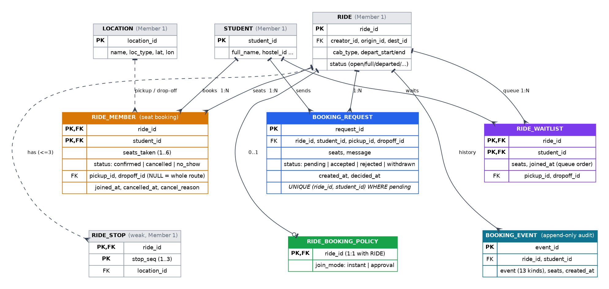

# PoolUp · Booking + Ride Pooling / Seat Management

> **Module deep-dive, written by Member 2 while building the module on its own.** In the integrated repository the files are numbered by layer (`db/1x` tables, `2x` logic, `3x` views, `4x` indexes, `db/queries/` named queries) and the references below have been updated to those names. Stand-in tables and the temporary `X-Student-Id` header mentioned in some passages were replaced at integration by the real tables and by Member 1's login; see `../INTEGRATION_NOTES.md`.


DBMS Module Design Document · Member 2 · PostgreSQL 16

**Module purpose.** Let a BITS Hyderabad student take seats on a shared cab ride that someone else offered: book instantly or ask for approval, board and leave at intermediate stops, wait in a queue when the cab is full and be promoted automatically when a seat frees up, cancel, and let the ride creator manage passengers through departure and completion. Every business rule is enforced inside PostgreSQL, not in application code.

| At a glance |  |
|---|---|
| New tables | 5 (ride_member made real, ride_booking_policy, booking_request, ride_waitlist, booking_event); 3,484 rows seeded across them |
| Declarative constraints | 13 CHECK, 15 FOREIGN KEY, 5 PRIMARY KEY, 1 partial UNIQUE index (request_one_pending) |
| Triggers | 13 on the booking tables and on ride (12 trigger functions) |
| Stored functions | 15 (book, cancel, remove rider, waitlist, request decisions, ride lifecycle, route helpers) |
| Views / indexes / queries | 4 views · 6 measured indexes · 11 analytical queries with EXPLAIN ANALYZE |
| Verification | 13 new automated tests (25/25 passing together with Member 1's 12) · 20/20 Booking Lab scenarios · merge check against Member 5's module passes |


## 1. Requirements Analysis


### 1.1 Problem

Member 1 lets a student offer a ride and search for rides. Nothing yet answers "how do I actually get a seat?". Without a booking module two people can grab the last seat, a student can hold seats in two cabs at the same time, a full ride is a dead end, and nobody knows who is travelling. This module owns the seat: who holds it, for which part of the route, and how it changes hands.


### 1.2 Users

| User | What they do |
|---|---|
| Rider | Searches (Member 1), books a seat or sends a request, chooses where to board and leave, joins a waitlist for a full ride, cancels, sees their bookings and a notification feed. |
| Ride creator | Chooses instant booking or approval, accepts or rejects requests, removes a rider, starts the ride, records no-shows, completes the ride. |
| Admin / evaluator | Booking SQL library (11 queries with plans) and Booking Lab (20 scenarios that prove the rules live and are always rolled back). |


### 1.3 Functionality

- **Book a seat**: one stored function `fn_book_seat` decides the outcome: `confirmed`, `requested` (creator must approve) or `waitlisted`.
- **Ride pooling**: a rider may board at a stop and/or get off at a stop; both must lie on the ride's route (origin, up to 3 stops, destination), boarding before leaving.
- **Seat management**: the sum of confirmed seats can never exceed the cab capacity; the ride flips between `open` and `full` automatically.
- **Waitlist**: first-come first-served queue for full rides; when seats free up the database promotes people automatically (first-fit FIFO).
- **Approval mode**: per-ride policy; requests have their own state machine (pending, accepted, rejected, withdrawn).
- **Cancellation**: riders cancel until departure; the creator can remove a rider; when the creator cancels the ride all riders, requests and the waitlist are released.
- **Ride lifecycle**: start, record no-shows, complete. `completed_at` and member statuses are exactly what Member 5 (ratings) needs.
- **Audit trail**: an append-only `booking_event` feed written by triggers (13 event kinds), shown as notifications.


### 1.4 Assumptions

- A booking is for 1 to 6 seats; whether it fits is decided by the cab type (Member 1).
- The creator's seat is created by Member 1's trigger and is never cancelled separately (cancel the ride instead).
- Bookings close when the ride's departure window ends; a ride can be started at most 30 minutes before its window.
- Whole-ride seat accounting: a seat is held for the whole trip even if the rider leaves at a stop. Reusing a seat on the legs after a drop-off is a possible extension, not implemented (it would change how Member 1's search counts seats).
- Fares: this module only shows an estimate (fare divided by seats booked). The binding split belongs to Member 3 (expense splitting).


### 1.5 Business Rules and Enforcement

Same design principle as Member 1: a rule checkable on one row is declarative (CHECK / UNIQUE / FK); a rule that needs other rows or time is a trigger. Trigger violations raise `ERRCODE 23514` with `CONSTRAINT = rule_...`, so the API translates both kinds the same way. Authorisation failures use SQLSTATE `42501` (HTTP 403).

| ID | Rule | Enforced by |
|---|---|---|
| B1 | A booking is for 1 to 6 seats | CHECK member_seats_range |
| B2 | Booking status is confirmed / cancelled / no_show | CHECK member_status_values |
| B3 | Pickup differs from drop-off (booking, request, waitlist) | CHECK ×3 |
| B4 | Pickup / drop-off / ride / student exist | FOREIGN KEY ×4 |
| B5 | Pickup and drop-off lie on the ride's route, pickup first | BEFORE trigger member_40_segment (+ fn_check_segment) |
| B6 | Confirmed seats never exceed cab capacity | BEFORE trigger member_20_capacity + row lock on the ride |
| B7 | Only open rides inside their departure window accept new seats | same trigger: rule_ride_full / rule_ride_not_bookable / rule_booking_closed |
| B8 | A student cannot hold seats on two overlapping rides | BEFORE trigger member_30_no_overlap + row lock on the student |
| B9 | The creator cannot book their own ride | rule_own_ride (function and waitlist/request guard trigger) |
| B10/B11 | One booking row per (ride, student); no second booking while one is active | PRIMARY KEY + rule_already_member |
| B12 | Booking status flow: confirmed → cancelled / no_show; cancelled → confirmed (re-book) | BEFORE UPDATE trigger member_10_status_flow |
| B13 | The creator's seat cannot be cancelled | same trigger: rule_creator_seat_locked |
| B14 | No cancelling once the ride has departed | same trigger: rule_cancel_after_departure |
| B15 | A no-show can only be recorded after departure | same trigger: rule_no_show_needs_departure |
| B16 | Cancellation details only on cancelled bookings | CHECK member_cancel_fields |
| W1/W2 | One waitlist spot per ride; waiting only if the seats do not fit right now | PRIMARY KEY + trigger waitlist_20_needed |
| W3 | Freed seats go to the queue automatically, first-fit FIFO | AFTER trigger member_90_after → fn_promote_waitlist |
| Q1 | At most one pending request per student and ride | partial UNIQUE index request_one_pending |
| Q2/Q3 | Request flow pending → accepted / rejected / withdrawn; decided_at set exactly when decided | BEFORE trigger request_20_flow + CHECK |
| P1 | Join mode is instant or approval | CHECK policy_join_mode_values |
| L1 | Start ≤ 30 min before the window; complete only after it began | rule_too_early_to_depart in fn_start_ride / fn_complete_ride |
| L2 | Cancelling a ride releases riders, requests and waitlist; departing clears waitlist and requests | AFTER trigger ride_lifecycle on ride |
| A1 | Only the creator starts, completes, removes riders, decides requests, sets the policy | fn_require_creator → SQLSTATE 42501 |
| E1 | Booking history is append-only | BEFORE UPDATE trigger event_immutable |


## 2. ER / EER Model

Five tables belong to this module. RIDE_MEMBER is the many-to-many relationship between STUDENT and RIDE, promoted to an entity because it carries attributes (seats, status, pickup, drop-off, cancellation). BOOKING_REQUEST and RIDE_WAITLIST are two other many-to-many relationships between the same entities with their own life cycles. RIDE_BOOKING_POLICY is an optional 1:1 extension of RIDE; BOOKING_EVENT is an append-only history.



*Figure 1 · ER / EER model of the booking module (grey = Member 1's entities, coloured = this module).*


### 2.1 Modelling decisions

| Construct | Decision | Justification |
|---|---|---|
| M:N → entity | RIDE_MEMBER (ride_id, student_id) with seats, status, pickup, drop-off | The relationship has attributes and a life cycle. Keeps the PK and column names Members 3 and 5 already rely on. |
| Three ways to join | Booking, request and waitlist are separate tables, not status values of one table | Each has different keys and rules (partial unique pending request, FIFO order). Counting seats only has to look at confirmed rows of one table. |
| Optional 1:1 | RIDE_BOOKING_POLICY only has a row when a creator changes the default | No row = instant booking, so Member 1's rides need no migration and no NULLs on RIDE. |
| Role of LOCATION | pickup_id / dropoff_id are NULL when the rider uses the whole route | A fourth role of LOCATION; the route check reuses the same path (origin, stops, destination) as Member 1's search. |
| Derived data | Seats left, fill %, waitlist position, reliability are views, never stored | No update anomalies; always consistent with RIDE_MEMBER. |
| History | BOOKING_EVENT is written by triggers and cannot be updated | Audit and notification feed without application involvement. |


## 3. Relational Schema

| Relation | Definition |
|---|---|
| RIDE_MEMBER | (ride_id → RIDE ON DELETE CASCADE, student_id → STUDENT, seats_taken, status, joined_at, pickup_id → LOCATION, dropoff_id → LOCATION, cancelled_at, cancel_reason) PK (ride_id, student_id) |
| RIDE_BOOKING_POLICY | (ride_id → RIDE ON DELETE CASCADE, join_mode, updated_at) PK ride_id; join_mode ∈ {instant, approval} |
| BOOKING_REQUEST | (request_id, ride_id → RIDE, student_id → STUDENT, seats, pickup_id, dropoff_id, message, status, created_at, decided_at) status ∈ {pending, accepted, rejected, withdrawn}; UNIQUE (ride_id, student_id) WHERE status = 'pending' |
| RIDE_WAITLIST | (ride_id → RIDE, student_id → STUDENT, seats, pickup_id, dropoff_id, joined_at) PK (ride_id, student_id) |
| BOOKING_EVENT | (event_id, ride_id → RIDE, student_id → STUDENT, event, seats, created_at) 13 event kinds |


### 3.1 Domains and data types

| Column | Type | Why |
|---|---|---|
| seats_taken, seats | SMALLINT + CHECK 1..6 | Small closed range; capacity per cab is checked by a trigger because it depends on other rows. |
| status columns | VARCHAR + CHECK (…values…) | Small closed vocabularies; transitions are guarded by triggers. |
| joined_at, cancelled_at, created_at, decided_at | TIMESTAMPTZ | Time-zone-safe instants; "late cancellation" and lead-time analytics are interval arithmetic. |
| cancel_reason | VARCHAR(14) CHECK in (self, removed, ride_cancelled) | Distinguishes who ended the booking; drives the audit event and the reliability view. |
| pickup_id / dropoff_id | SMALLINT FK, nullable | Same type as LOCATION.location_id; NULL means origin / destination. |


## 4. Normalization

| Relation | Candidate keys | Result |
|---|---|---|
| RIDE_MEMBER | (ride_id, student_id) | All attributes depend on the whole key; names, hostel, fare are looked up from STUDENT / RIDE / CAB_TYPE, never copied. BCNF. |
| BOOKING_REQUEST | request_id; (ride_id, student_id) among pending rows | Surrogate key because a student may ask again after a rejected or withdrawn request. No transitive dependencies. BCNF. |
| RIDE_WAITLIST | (ride_id, student_id) | Queue position is not stored (it would change whenever someone leaves); it is computed with ROW_NUMBER() from joined_at. BCNF. |
| RIDE_BOOKING_POLICY | ride_id | One attribute depends on the key. BCNF. |
| BOOKING_EVENT | event_id | Facts about one occurrence. BCNF. |

**Deliberate denormalisation: none.** Seats left, fill % and fare per head are not stored. The one thing kept in two places is `ride.status` = full/open, which mirrors the seat count; a trigger updates it in the same transaction as every seat change, and a test asserts the invariant on the seeded data and after concurrent bookings.


## 5. Triggers, Functions and Views


### 5.1 Triggers

| Trigger | Table · timing · event | Purpose |
|---|---|---|
| event_immutable | booking_event · BEFORE · UPDATE | E1 append-only |
| request_10_guard | booking_request · BEFORE · INSERT | same pre-checks for requests |
| request_20_flow | booking_request · BEFORE · UPDATE | Q2 request state machine |
| request_90_log | booking_request · AFTER · INSERT/UPDATE | audit: requested / accepted / rejected / withdrawn |
| ride_lifecycle | ride · AFTER · UPDATE | L2 ride cancelled / departed releases waitlist, requests, riders |
| member_10_status_flow | ride_member · BEFORE · UPDATE | B12-B15 state machine + cancellation fields |
| member_20_capacity | ride_member · BEFORE · INSERT/UPDATE | B6-B7 capacity + bookable window (locks the ride row) |
| member_30_no_overlap | ride_member · BEFORE · INSERT/UPDATE | B8 no overlapping rides (locks the student row) |
| member_40_segment | ride_member · BEFORE · INSERT/UPDATE | B5 pickup / drop-off on the route |
| member_90_after | ride_member · AFTER · INSERT/UPDATE | keep ride open/full, write audit event, promote the waitlist |
| waitlist_10_guard | ride_waitlist · BEFORE · INSERT | ride bookable, not own ride, not already a rider, valid segment |
| waitlist_20_needed | ride_waitlist · BEFORE · INSERT | W2 waiting only if the seats do not fit |
| waitlist_90_log | ride_waitlist · AFTER · INSERT | audit: waitlisted |

PostgreSQL fires triggers of one event in alphabetical order, so the numeric prefixes (10, 20, 30, 40, 90) make the order explicit and are part of the design: status flow first, then capacity, overlap, route, and the AFTER trigger last.


### 5.2 Stored functions (each runs in one transaction)

| Function | Purpose |
|---|---|
| fn_book_seat(student, ride, seats, pickup, dropoff, message, waitlist) | Locks the ride, validates, then confirms, creates a request, or joins the waitlist. Returns the outcome. |
| fn_cancel_booking / fn_remove_rider | Rider cancels / creator removes. The trigger frees the seat and promotes the waitlist. |
| fn_promote_waitlist(ride) | First-fit FIFO promotion; a clashing or too-large entry is skipped and keeps its place (EXCEPTION block = sub-transaction). |
| fn_decide_request / fn_withdraw_request / fn_leave_waitlist | Request and waitlist workflow. |
| fn_set_join_mode / fn_start_ride / fn_complete_ride / fn_mark_no_show | Creator tools; creator check by fn_require_creator (SQLSTATE 42501). |
| fn_ride_path / fn_check_segment / fn_seeding | Helpers: route as a table, route validation, seeding switch (same convention as Member 1). |


### 5.3 Views

| View | Purpose |
|---|---|
| v_ride_occupancy | Seat inventory per ride: seats taken / left, riders, waitlist size, pending requests, join mode, fill %. |
| v_ride_manifest | Passenger list with names, hostel and boarding / leaving points (defaults resolved). |
| v_waitlist_position | ROW_NUMBER() queue position per ride. |
| v_student_booking_stats | Bookings, self-cancellations, no-shows, trips taken, reliability %. |


### 5.4 State machines

| Entity | Allowed moves |
|---|---|
| ride_member.status | confirmed → cancelled / no_show;  cancelled → confirmed (re-booking);  no_show is terminal |
| booking_request.status | pending → accepted / rejected / withdrawn;  all others terminal |
| ride.status (Member 1) | open ⇄ full is now driven by seat changes (trigger); open/full → departed (creator); departed → completed (creator); open/full → cancelled (cascade) |


### 5.5 Excerpt: fn_book_seat (db/25_booking_logic.sql)

```sql
CREATE OR REPLACE FUNCTION fn_book_seat(p_student text, p_ride int, p_seats int DEFAULT 1,
    p_pickup int DEFAULT NULL, p_dropoff int DEFAULT NULL, p_message text DEFAULT NULL,
    p_waitlist boolean DEFAULT false) RETURNS text LANGUAGE plpgsql AS $$
...
  SELECT r.status, r.creator_id, r.depart_end INTO v FROM ride r
   WHERE r.ride_id = p_ride FOR UPDATE OF r;          -- serialise everyone competing for this ride
  ... own ride / already member / status / window / fn_check_segment checks ...
  v_left := fn_seats_left(p_ride);
  IF v_left < p_seats THEN
    IF p_waitlist THEN INSERT INTO ride_waitlist (...) VALUES (...); RETURN 'waitlisted'; END IF;
    RAISE EXCEPTION 'This ride is full - you can join the waitlist'
      USING ERRCODE = '23514', CONSTRAINT = 'rule_ride_full';
  END IF;
  SELECT join_mode INTO v_mode FROM ride_booking_policy WHERE ride_id = p_ride;
  IF COALESCE(v_mode, 'instant') = 'approval' THEN
    INSERT INTO booking_request (...) VALUES (...); RETURN 'requested';
  END IF;
  INSERT INTO ride_member (...) VALUES (..., 'confirmed', ...)
  ON CONFLICT (ride_id, student_id) DO UPDATE SET status = 'confirmed', ...;   -- re-booking
  RETURN 'confirmed';   -- triggers: capacity, overlap, route (before); full/open + audit (after)
```


## 6. Queries

Eleven named analytical queries, all raw parameterised SQL (no ORM). Each can be opened in the **Booking SQL** page with its DBMS concepts, result table and EXPLAIN ANALYZE plan. Row counts and execution times below are from the seeded database.

| # | Query | DBMS concepts | Rows | ms |
|---|---|---|---|---|
| 1 | `fill_by_route` · Which routes fill their cars best? (window function RANK) | GROUP BY, HAVING, RANK() OVER, view, derived table | 10 | 102.3 |
| 2 | `cancellation_lead_time` · How early do riders cancel? (CASE buckets + share of total) | CASE, derived table, GROUP BY, window function (share of total) | 5 | 0.5 |
| 3 | `request_funnel` · Approval requests: how are they decided? (CTE + FILTER) | CTE, FILTER, conditional aggregation, interval arithmetic | 4 | 0.1 |
| 4 | `waitlist_queue` · Full rides with a queue (aggregate over a view, HAVING) | view, JOIN x3, GROUP BY, HAVING, aggregate | 12 | 0.5 |
| 5 | `no_show_by_hostel` · No-show rate by hostel (conditional aggregation, HAVING) | JOIN x3, FILTER, HAVING, NULLIF | 12 | 4.6 |
| 6 | `boarding_points` · Where do riders board or leave mid-route? (UNION ALL + FILTER) | UNION ALL, derived table, FILTER, JOIN | 10 | 0.5 |
| 7 | `rider_reliability` · Reliability quartiles of regular riders (NTILE) | view, NTILE() OVER, window function, derived table | 12 | 1.8 |
| 8 | `co_rider_pairs` · Pairs who keep sharing rides (self-join) | self-join, a.student_id < b.student_id, HAVING, JOIN x2 | 10 | 7.3 |
| 9 | `seat_utilisation` · Seat utilisation by cab and status (ROLLUP subtotals) | ROLLUP, GROUPING(), view, aggregate | 17 | 29.7 |
| 10 | `booking_lead_time` · How far ahead do people book? (percentile_cont) | percentile_cont, ordered-set aggregate, derived table, GROUP BY | 4 | 3.2 |
| 11 | `seat_inventory_now` · Upcoming seat inventory with a running total (window frame) | view, SUM() OVER (ORDER BY), running total, JOIN | 15 | 56.6 |


### 6.1 Sample results (live from the seeded database)

**fill_by_route**: Which routes fill their cars best? (window function RANK)

| origin | destination | rides | avg_fill_pct | fill_rank |
|---|---|---|---|---|
| RGIA Airport (Shamshabad) | BPHC Hostel Circle | 11 | 70.5 | 1 |
| Hyderabad Deccan (Nampally | BPHC Main Gate | 12 | 66.7 | 2 |
| Secunderabad Jn | BPHC Main Gate | 29 | 61.8 | 3 |
| BPHC Main Gate | JBS Secunderabad | 8 | 61.5 | 4 |
| BPHC Hostel Circle | Ameerpet | 9 | 60.2 | 5 |
| BPHC Hostel Circle | GVK One | 9 | 60.2 | 5 |

**cancellation_lead_time**: How early do riders cancel? (CASE buckets + share of total)

| bucket | cancellations | share_pct |
|---|---|---|
| 1. under 2 h (late) | 18 | 24.7 |
| 2. 2 to 12 h | 40 | 54.8 |
| 3. 12 to 24 h | 8 | 11 |
| 4. 1 to 3 days | 1 | 1.4 |
| 5. over 3 days | 6 | 8.2 |

**request_funnel**: Approval requests: how are they decided? (CTE + FILTER)

| status | requests | share_pct | avg_minutes_to_decide |
|---|---|---|---|
| accepted | 101 | 72.1 | 90 |
| withdrawn | 15 | 10.7 | 120 |
| rejected | 14 | 10 | 120 |
| pending | 10 | 7.1 |  |

**seat_utilisation**: Seat utilisation by cab and status (ROLLUP subtotals)

| cab_type | ride_status | rides | seats_offered | seats_used | utilisation_pct |
|---|---|---|---|---|---|
| auto | completed | 77 | 231 | 152 | 65.8 |
| auto | full | 8 | 24 | 24 | 100 |
| auto | open | 16 | 48 | 25 | 52.1 |
| auto | all statuses | 101 | 303 | 201 | 66.3 |
| mini | completed | 188 | 752 | 426 | 56.6 |
| mini | full | 6 | 24 | 24 | 100 |


## 7. Indexing and Performance

With 700 demo rides PostgreSQL correctly prefers sequential scans, so every index was measured on a scratch database with **150,000 rides, 449,970 bookings, 50,000 waitlist entries, 244,500 requests and 1,200,000 events** (generated by `server/scripts/bench.mjs`; raw numbers in `server/scripts/bench_result.json`). Each index was dropped, the query re-run, the index re-created, the query re-run (best of 5, EXPLAIN (ANALYZE, BUFFERS)).

| Query | Index | Without index | With index | Speed-up |
|---|---|---|---|---|
| Seats taken for rides departing in the next 2 days (seat map / search) | `member_confirmed_seats_idx` | 165.511 ms · ->  Parallel Seq Scan on ride_member · 6443 buf | 44.842 ms · ->  Parallel Seq Scan on ride · 6327 buf | 3.7× |
| Waitlist queue of one ride in FIFO order (promotion) | `waitlist_fifo_idx` | 0.014 ms · ->  Index Scan using ride_waitlist_pkey on ride_waitlist · 2 buf | 0.014 ms · ->  Index Scan using ride_waitlist_pkey on ride_waitlist · 2 buf | 1× |
| Latest 40 notifications of one student | `event_student_idx` | 124.368 ms · ->  Parallel Seq Scan on booking_event · 11289 buf | 0.051 ms · ->  Index Scan using event_student_idx on booking_event · 43 buf | 2438.6× |
| My requests, newest first | `request_student_idx` | 29.644 ms · ->  Parallel Seq Scan on booking_request · 2812 buf | 0.047 ms · ->  Bitmap Heap Scan on booking_request · 28 buf | 630.7× |
| Creator inbox: pending requests of 20 rides | `request_one_pending` | n/a (unique index, needed for the rule) | 0.038 ms · Index Scan using request_one_pending on booking_request · 60 buf | - |

**Honest findings.** The index `waitlist_fifo_idx (ride_id, joined_at, student_id)` that I first proposed gained nothing (the primary key already answers a single-ride queue in about 0.01 ms), so it was **removed** from the delivered schema. The pending-requests index is the partial UNIQUE index that already enforces rule Q1, so no extra index is needed. `event_ride_idx` supports the ON DELETE CASCADE foreign key and was not benchmarked separately.


### 7.1 Index catalogue

| Index | Definition | Serves |
|---|---|---|
| member_confirmed_seats_idx | ride_member (ride_id) INCLUDE (seats_taken) WHERE status = 'confirmed' | seat counting (index-only scan), seat map, search |
| request_one_pending | UNIQUE booking_request (ride_id, student_id) WHERE status = 'pending' | rule Q1 and the creator's inbox |
| request_student_idx | booking_request (student_id, created_at DESC) | "my requests" |
| event_student_idx | booking_event (student_id, created_at DESC) | notification feed |
| event_ride_idx | booking_event (ride_id, event_id) | FK cascade, history of one ride |
| ride_member_student_idx (Member 1) | ride_member (student_id, status) | "my bookings", overlap checks |


## 8. Transactions and Concurrency

| Concern | Mechanism | Evidence |
|---|---|---|
| Last seat contested by many riders | Capacity trigger and fn_book_seat both do SELECT … FOR UPDATE on the ride row; under READ COMMITTED each waiter re-reads the committed seat count after getting the lock. | Test: 6 people book 2 free seats in parallel → exactly 2 succeed, 4 get rule_ride_full / rule_seat_capacity, seats_left = 0, ride = full. |
| Same student, two overlapping rides at once | Row lock on the STUDENT row inside the overlap trigger (same pattern as Member 1's ride creation). | Test: two parallel bookings → exactly 1 confirmed, the other rule_member_overlap. |
| Lock order / deadlocks | Everything locks ride first, then student (fn_decide_request reads the request without locking, locks the ride, then the request). Member 1's fn_create_ride locks student first but only touches a brand-new ride row nobody else can wait on. | No deadlock in the parallel tests; the order is documented in the code. |
| Cancel and promotion are atomic | Promotion runs inside the AFTER trigger of the cancelling statement: free seat, promote, mark ride full again, audit rows commit together or not at all. | Waitlist test: cancellation of a 2-seat booking promotes the first fitting entry; the queue is consistent afterwards. |
| A bad entry cannot block the queue | Promotion wraps each insert in a PL/pgSQL EXCEPTION block (sub-transaction). A clashing entry is skipped and keeps its place. | Covered by the first-fit logic; entries that do not fit stay queued (test). |
| Isolation level | READ COMMITTED is enough: the cross-row invariants (capacity, overlap) are protected by explicit row locks instead of raising isolation to SERIALIZABLE (which would force retry loops). | Concurrency tests above. |
| Safe demonstrations | Booking Lab runs every scenario in BEGIN … ROLLBACK. | Test asserts row counts of 8 tables are identical before and after all 20 scenarios. |


## 9. Application Architecture

The booking module adds one Express router (`/api/bookings`), one for the SQL library (`/api/booking-insights`) and one for the lab (`/api/booking-lab`). The routes call the stored functions and shape JSON; `errors.js` (shared with Member 1) maps SQLSTATE + constraint name to a rule id, mechanism chip and readable text.

| Endpoint | Purpose |
|---|---|
| GET /api/bookings/preview/:id | What would happen if I tried: route points, seats, join mode, clash warning, fare per head if I join, can = book / request / waitlist / none |
| POST /api/bookings | fn_book_seat → confirmed / requested / waitlisted |
| GET /api/bookings/mine · /hosting · /full · /events · /ride/:id | My seats + requests + waitlist + stats; rides I host with inbox, passengers, queue; full rides to wait for; notification feeds; seat map |
| POST /ride/:id/cancel · /waitlist/leave · /requests/:id/withdraw | Rider actions |
| POST /requests/:id/decide · /ride/:id/remove · /policy · /start · /complete · /no-show | Creator actions (403 for anyone else) |
| GET /api/booking-insights[/:name[/explain]] | 11 analytical queries and their plans |
| GET /api/booking-lab · POST /:id/run | 20 integrity scenarios, always rolled back |


## 10. Testing and Verification

`npm test` rebuilds the database from the SQL files and seed, then exercises the real API against PostgreSQL: **25 / 25 pass** (Member 1's 12 unchanged plus these 13).

| # | Test | What it proves |
|---|---|---|
| 1 | Seed + invariants | All five tables populated; no open ride without seats, no full ride with free seats, nothing overbooked, no waitlist on a ride with seats |
| 2 | Book a seat | Seats drop, ride flips to full, duplicate / own ride / too many seats rejected, same rule fires on direct SQL |
| 3 | Seat race | 6 parallel bookings for 2 seats → exactly 2 succeed |
| 4 | Student race | two overlapping rides at once → exactly 1 succeeds |
| 5 | Waitlist | FIFO, first-fit, auto-promotion, one spot per ride, waiting refused when seats exist, audit events |
| 6 | Approval mode | request, one pending, only the creator decides, withdraw |
| 7 | Ride pooling | wrong order / off-route / identical stops rejected; boarding at a stop is saved and shown in the manifest |
| 8 | Cancel / remove / cascade | creator seat protected, re-booking works, ride cancel releases riders and keeps the creator row |
| 9 | Lifecycle | start too early rejected, no-show, complete, cancel after departure rejected, status log |
| 10 | Member 1 integration | search shows fewer seats, full rides leave the results and appear for the waitlist |
| 11 | Direct SQL | CHECK and trigger rules guard inserts that bypass the API |
| 12 | Insights | all 11 queries run; EXPLAIN works |
| 13 | Booking Lab | 20 / 20 scenarios behave as documented; nothing persisted |

**Merge check** (`server/scripts/merge_check.mjs`): loads Member 5's ratings and analytics SQL on top of this schema, then runs create → book → depart → no-show → complete → rate. All steps pass: a rating between two travelled riders is accepted, rating a no-show is rejected by Member 5's rule, and the analytics views run on the merged data.


## 11. Integration with the other modules

- **Member 1 (users + rides)**: the stand-in `ride_member` is replaced by the real table (same PK and columns). Member 1's search, ride board, "My rides", overlap rule R10 and creator-joins trigger work unchanged. Their "Request to join" button now opens the booking dialog. Changes to Member 1's files are listed in docs/INTEGRATION_M2.md.
- **Member 3 (expense splitting)** can read confirmed seats and each rider's boarding / leaving points from `v_ride_manifest`; only `status = 'confirmed'` rows on completed rides share the fare. The estimate shown here is deliberately not stored.
- **Member 4 (payments)** can rely on `no_show` and `cancelled` statuses to decide who owes what.
- **Member 5 (ratings + analytics)**: the contract is kept: PK (ride_id, student_id), `seats_taken`, status in confirmed / cancelled / no_show, `completed_at` set by `fn_complete_ride`. One known conflict outside this module: Members 1 and 5 both create an index called `ride_member_student_idx`; drop one of the two CREATE INDEX lines when merging (the merge check does this).


## 12. Application Screenshots

Captured from the running application (PostgreSQL 16, Express, React) with the seeded dataset, following the demo storyline: book instantly, request approval, join a waitlist, cancel and trigger a promotion, accept a request, then the lab and the SQL library.

*Figure 2 · Find a ride: every result now has a working "Join this ride" button.* (screenshot in `pdf/M2_PoolUp_Booking_Seats_Module.pdf`)

*Figure 2 · Find a ride: every result now has a working "Join this ride" button.*

*Figure 3 · Booking dialog: seats, where to board / get off, fare per head if you join.* (screenshot in `pdf/M2_PoolUp_Booking_Seats_Module.pdf`)

*Figure 3 · Booking dialog: seats, where to board / get off, fare per head if you join.*

*Figure 4 · Seat booked: the confirmation shows seats left.* (screenshot in `pdf/M2_PoolUp_Booking_Seats_Module.pdf`)

*Figure 4 · Seat booked: the confirmation shows seats left.*

*Figure 5 · Approval-mode ride: the same dialog sends a request with a message.* (screenshot in `pdf/M2_PoolUp_Booking_Seats_Module.pdf`)

*Figure 5 · Approval-mode ride: the same dialog sends a request with a message.*

*Figure 6 · Full rides on the route are listed under the results; join the waitlist.* (screenshot in `pdf/M2_PoolUp_Booking_Seats_Module.pdf`)

*Figure 6 · Full rides on the route are listed under the results; join the waitlist.*

*Figure 7 · Waitlist dialog: promoted automatically, first come first served.* (screenshot in `pdf/M2_PoolUp_Booking_Seats_Module.pdf`)

*Figure 7 · Waitlist dialog: promoted automatically, first come first served.*

*Figure 8 · My seats: bookings, waitlist position, pending requests, reliability stats.* (screenshot in `pdf/M2_PoolUp_Booking_Seats_Module.pdf`)

*Figure 8 · My seats: bookings, waitlist position, pending requests, reliability stats.*

*Figure 9 · Cancelling a seat: the database promotes the next person on the waitlist.* (screenshot in `pdf/M2_PoolUp_Booking_Seats_Module.pdf`)

*Figure 9 · Cancelling a seat: the database promotes the next person on the waitlist.*

*Figure 10 · Hosting: join policy, request inbox, passengers with Remove / No-show, waitlist, Start / Complete.* (screenshot in `pdf/M2_PoolUp_Booking_Seats_Module.pdf`)

*Figure 10 · Hosting: join policy, request inbox, passengers with Remove / No-show, waitlist, Start / Complete.*

*Figure 11 · After accepting a request: the seat is booked and seats left drop.* (screenshot in `pdf/M2_PoolUp_Booking_Seats_Module.pdf`)

*Figure 11 · After accepting a request: the seat is booked and seats left drop.*

*Figure 12 · Activity: audit trail written by triggers (my bookings and what happened on my rides).* (screenshot in `pdf/M2_PoolUp_Booking_Seats_Module.pdf`)

*Figure 12 · Activity: audit trail written by triggers (my bookings and what happened on my rides).*

*Figure 13 · Booking Lab: all scenarios run, each rejected by the database exactly as expected, then rolled back.* (screenshot in `pdf/M2_PoolUp_Booking_Seats_Module.pdf`)

*Figure 13 · Booking Lab: all scenarios run, each rejected by the database exactly as expected, then rolled back.*

*Figure 14 · Booking SQL library: query, concepts, result table and EXPLAIN ANALYZE plan.* (screenshot in `pdf/M2_PoolUp_Booking_Seats_Module.pdf`)

*Figure 14 · Booking SQL library: query, concepts, result table and EXPLAIN ANALYZE plan.*


## 13. Limitations and honest notes

- Seats are held for the whole trip; reusing a seat after a rider leaves at a stop is not modelled.
- The seeded history for requests, waitlists and cancellations is generated by `seed_booking.js` (deterministic). It is demo data, not real behaviour. The demo storyline rides (#701-#705) are labelled in their notes.
- Member 1's seed wrote some booking times in the future; `seed_booking.js` normalises them to be after the ride was created and before now.
- Waitlist promotion is first-fit: a large request at the head of the queue does not block smaller ones behind it. Alternative policies (strict FIFO) are a one-line change in `fn_promote_waitlist`.
- A student with an overlapping ride is skipped (not removed) from the waitlist at promotion time and keeps their place; there is no notification for that skip.
