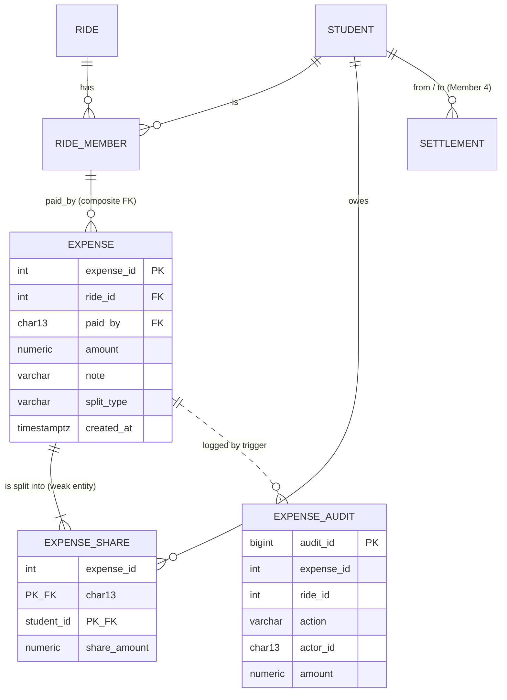

# PoolUp – Expense Splitting module (Member 3): design notes

> **Module deep-dive, written by Member 3 while building the module on its own.** In the integrated repository the files are numbered by layer (`db/1x` tables, `2x` logic, `3x` views, `4x` indexes, `db/queries/` named queries) and the references below have been updated to those names. Stand-in tables and the temporary `X-Student-Id` header mentioned in some passages were replaced at integration by the real tables and by Member 1's login; see `../INTEGRATION_NOTES.md`.

**Goal:** Splitwise-style cost sharing for cab pools. One rider pays the cab; the module splits the cost, tracks who owes whom, and suggests the fewest payments to settle. All the business rules live in the **database** (constraints, triggers, functions); the API only reports which rule fired.

## ER diagram (Mermaid)

`expense_share` is a **weak entity** (identified by `(expense_id, student_id)`). `expense_audit` deliberately has no FK so history survives deletion.

## Business rules (all enforced in PostgreSQL)

| Rule | Mechanism | Rule |
|---|---|---|
| E1 / E2 | CHECK | amount > 0 and ≤ ₹50,000 |
| E3 / E4 | CHECK | description not blank; split ∈ equal/seats/exact/percent |
| E5 | composite FOREIGN KEY → `ride_member` | payer must be on the ride |
| E6 | BEFORE INSERT trigger | only on `departed` / `completed` rides |
| E7 | BEFORE INSERT trigger | payer must be a **confirmed** rider (not no-show/cancelled) |
| E8 | BEFORE INSERT trigger on shares | only confirmed riders can be in the split |
| E9 | PRIMARY KEY `(expense_id, student_id)` | no duplicate person in a split |
| E12–E15 | function checks (`fn_expense_shares`) | at least one person; valid weights; exact amounts sum to total; percentages sum to 100 |
| E16 | **DEFERRED constraint trigger** | shares add up to the amount, checked at COMMIT |
| E17 | BEFORE UPDATE triggers | amount/payer/ride/split and shares are immutable |
| E18 | BEFORE DELETE trigger | no deleting once a payment exists for the ride (cascades still work) |
| E19 | function check | only the payer can delete |
| – | AFTER INSERT/DELETE trigger | audit trail with actor |

## Key algorithms

* **`fn_split_amount`** – largest-remainder method in whole paise: ₹100 over 3 people → 33.34 / 33.33 / 33.33. Shares always sum to the exact amount, no drift. Works for equal, by-seats, exact and percent (they only differ in the weights).
* **`fn_expense_shares`** – validation + shares; used by both the *preview* and the *insert*, so the preview is guaranteed identical to what is saved.
* **`fn_add_expense`** – expense + all shares in one atomic call.
* **`v_ride_ledger`** – per ride: paid − owed + settled_out − settled_in = net (sums to 0 for every ride).
* **`v_pairwise_balance`** – net position between every pair of students across all rides (settlements are negative debt edges).
* **`fn_simplify_debts`** – greedy min-cash-flow: n people need at most n−1 payments.

## Likely viva questions

1. **Why not store the split as floats?** NUMERIC(9,2) + whole-paise arithmetic; the sum is guaranteed by a deferred trigger.
2. **Why a deferred trigger for the sum?** The expense row and its shares are inserted in separate statements; the check must wait until COMMIT. (Lab scenario "Shares that do not add up" shows it firing.)
3. **Why is `expense_share` a weak entity?** It cannot exist without its expense; PK includes the owner's key; `ON DELETE CASCADE`.
4. **How do you stop a non-rider paying?** Composite FK into `ride_member` + trigger for confirmed status.
5. **How does deleting a ride still work if expenses are locked?** The lock trigger uses `pg_trigger_depth()` – cascades run at depth 2 and are exempt.
6. **Which normal form?** 3NF: shares depend on (expense, student); balances are derived in views, not stored.
7. **Concurrency?** `fn_delete_expense` takes `FOR UPDATE` on the expense row; creation is a single transaction.
8. **Indexes?** `(ride_id, paid_by)`, `paid_by`, `share(student_id)`, `audit(ride_id, happened_at DESC)` – see `EXPLAIN ANALYZE` in the SQL page.
