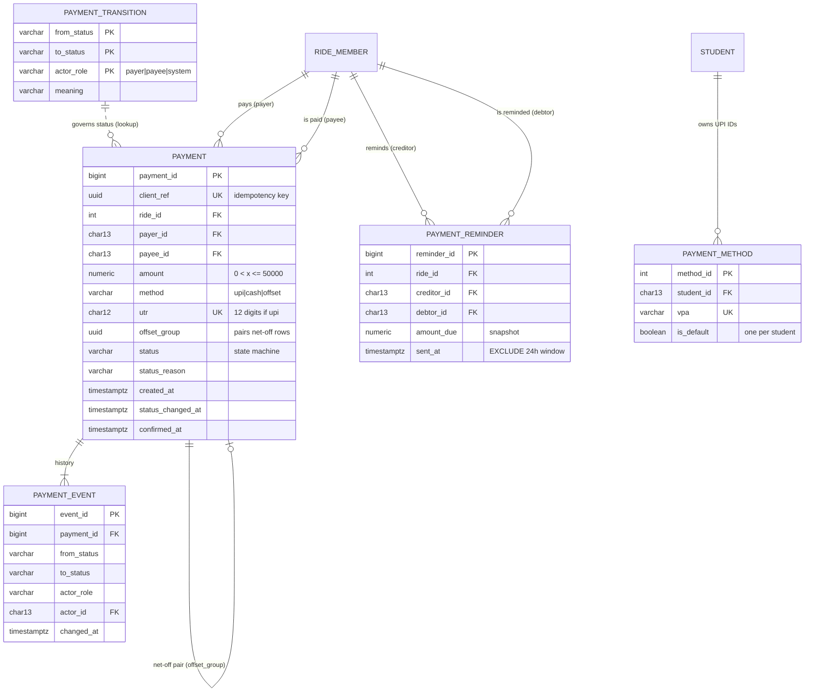

# PoolUp: Payments + Settlement module, database design

> **Module deep-dive, written by Member 4 while building the module on its own.** In the integrated repository the files are numbered by layer (`db/1x` tables, `2x` logic, `3x` views, `4x` indexes, `db/queries/` named queries) and the references below have been updated to those names. Stand-in tables and the temporary `X-Student-Id` header mentioned in some passages were replaced at integration by the real tables and by Member 1's login; see `../INTEGRATION_NOTES.md`.


**Owner:** Member 4 (Payments + Settlement)
**DBMS:** PostgreSQL 16 · **Files:** `db/60_payments_schema.sql`, `db/65_payment_transitions.sql`, `db/70_payments_logic.sql`, `db/75_payments_views.sql`, `db/80_payments_indexes.sql`, `db/90_payments_queries.sql`

Written so it can be pasted into the team's design PDF as this module's section, and so any team member can defend it in the viva.

---

## 1. Requirements analysis

### 1.1 Problem
After a pooled ride, one person usually pays the cab and maybe another pays the airport toll. Everyone else then owes "someone something", tracked over WhatsApp. People forget, pay twice, pay the wrong person, or claim they paid when they didn't. The module must record **who owes whom, who paid, and whether the money actually arrived**, without ever losing or double-counting a rupee.

### 1.2 Users
| User | What they do in this module |
|---|---|
| **Debtor (student)** | Sees what they owe per ride; records a UPI (with UTR) or cash payment; cancels a pending payment; nets off mutual debts |
| **Creditor (student)** | Confirms or rejects incoming payments; reverses a mistaken confirmation within 72 h; sends rate-limited reminders |
| **System** | Expires payments nobody responded to within 7 days |
| **Admin / evaluator** | Money dashboard: settlement rate, debt ageing, time to settle, disputes, books-balance check |

### 1.3 Functionality
1. **Balances per ride**: every ride is a small group ledger. Balance = paid − share + payments sent − payments received.
2. **Settlement plan**: the fewest transfers that settle a ride (stored function, greedy two-pointer).
3. **Record a payment** (UPI + 12-digit UTR, or cash). It is **idempotent**: a double-click or retry never pays twice.
4. **Confirm / reject / cancel / expire / reverse** through a **state machine stored as data**.
5. **Net-off**: when A owes B on one ride and B owes A on another, cancel the overlap with **no money moving**.
6. **Reminders**: at most one per debt per 24 h, enforced by an **EXCLUDE constraint**.
7. **UPI IDs**: many per student, exactly one default (partial unique index). The pay screen shows a UPI QR code.
8. **Statement** with a running balance, plus a **Money dashboard**.

### 1.4 Assumptions
- A1: **Group-ledger model.** Money is settled per ride, not per expense. If C owes ₹300 for the fare (paid by A) but A owes C ₹30 for the toll (paid by C), C simply owes A ₹270.
- A2: A payment is **only a claim until the payee confirms it**; only confirmed payments change balances. Pending payments **reserve** the debt so nobody pays it twice.
- A3: The app never moves real money. It records UPI/cash transfers made outside it, so the UTR is the evidence.
- A4: Time windows are fixed and defined once: 7 days to expiry (`fn_payment_expiry()`), 72 h to reverse (`fn_reversal_window()`), 24 h between reminders (`fn_reminder_window()`).
- A5: Member 3 guarantees Σ shares = expense amount. A deferred constraint trigger enforces this in the stub schema, because every ride's balances must sum to ₹0.

### 1.5 Business rules and where each is enforced

| ID | Rule | Enforced by | Object |
|---|---|---|---|
| PR1 | 0 < amount ≤ ₹50,000 | CHECK | `payment_amount_range` |
| PR2 | Nobody pays themself | CHECK | `payment_not_self` |
| PR3 | Payer **and** payee are members of that ride | **Composite FOREIGN KEY** ×2 | `payment_payer_on_ride`, `payment_payee_on_ride` |
| PR4 | UPI ⇔ 12-digit UTR; cash/offset have none | CHECK (regex) | `payment_utr_format` |
| PR5 | A UTR can be used only once | UNIQUE | `payment_utr_unique` |
| PR6 | Every submission carries a unique idempotency key | UNIQUE + function | `payment_client_ref_key`, `fn_record_payment` |
| PR7 | Rejection / reversal states a reason | CHECK | `payment_reason_required` |
| PR8 | The payer must owe on that ride | BEFORE INSERT trigger | `rule_payer_not_debtor` |
| PR9 | The payee must be owed on that ride | BEFORE INSERT trigger | `rule_payee_not_creditor` |
| PR10 | **No overpayment**: pending counts as reserved; concurrent payments on a ride are serialised | trigger + `SELECT … FOR UPDATE` on the ride row | `rule_no_overpayment` |
| PR11 | New payments start `pending` (net-off rows start `confirmed`) | trigger | `rule_payment_initial_state` |
| PR12 | Status moves only along `payment_transition`, by the right role | trigger + **state-machine table** | `rule_illegal_transition` |
| PR13 | Reverse ≤ 72 h after confirmation; expire only after 7 days | trigger | `rule_reversal_window`, `rule_expiry_too_early` |
| PR14 | Payments are **append-only**: never edited, never deleted, never back-dated | triggers | `rule_payment_immutable`, `rule_payment_no_delete`, `rule_payment_time` |
| PR15 | Net-off rows come in balanced mirrored pairs **checked at COMMIT**; they are final | **DEFERRABLE constraint trigger** | `rule_offset_unbalanced`, `rule_offset_final` |
| PR16 | ≤ 1 reminder per (ride, creditor, debtor) per 24 h; only for real debts | **EXCLUDE (GiST)** + trigger | `reminder_rate_limit`, `rule_nothing_owed` |
| PR17 | One default UPI ID per student; VPA format | **Partial UNIQUE index**, CHECK | `payment_method_one_default`, `payment_method_vpa_format` |
| PR18 | Every status change is logged | AFTER trigger → `payment_event` | `payment_event_trg` |
| PR19 | Only the payer or payee may act on a payment | stored function (SQLSTATE 42501) | `rule_not_a_party` |

**Design principle (same as the ratings module):** single-row rules are **declarative** (PR1–PR7, PR17). Rules needing other rows, the clock, the acting role or the commit point are **triggers** (PR8–PR16, PR18). Because BEFORE triggers run before CHECK/FK, the insert trigger deliberately **steps aside** when a declarative rule is about to fail, so each violation is reported by the mechanism that owns it.

---

## 2. ER / EER model



### Payment state machine (rows of `payment_transition`)

```
            ┌──── payee confirms ───────► confirmed ──── payee reverses (≤ 72 h) ──► reversed
  pending ──┼──── payee rejects  ───────► rejected        (reason required)
            ├──── payer cancels  ───────► cancelled
            └──── system, after 7 days ─► expired
```

### Modelling decisions

| Construct | Decision | Justification |
|---|---|---|
| **Aggregation** | PAYMENT relates two **RIDE_MEMBER** instances (payer, payee), the M:N relationship STUDENT–RIDE treated as an entity | Lets PR3 be a composite FK, the same pattern as RATING in Member 5's module |
| **State machine as an entity** | PAYMENT_TRANSITION stores the allowed edges and the role that may take each | Changing the business process means changing rows, not code; the trigger just does a lookup |
| **Weak entity / history** | PAYMENT_EVENT exists only for its payment and is written only by trigger | Complete, tamper-evident timeline (who, when, why) |
| **Recursive relationship** | Two PAYMENT rows of `method='offset'` share an `offset_group`: a 1:1 pairing of payments | A net-off is one business event recorded as two mirrored entries (double-entry), validated at COMMIT |
| **Derived data not stored** | Balances, plans, statements: all computed in `v_ride_balance` and functions | No stored balance can ever drift out of sync with the expenses and payments it summarises |
| **Specialisation (disjoint)** | PAYMENT by `method`: UPI (has UTR) / cash / offset (has offset_group, born confirmed) | Encoded with CHECK constraints in one table; the subclasses differ by two attributes, so separate tables would add joins with no benefit |

---

## 3. Relational schema

```
PAYMENT_METHOD     (method_id, student_id*, vpa UNIQUE, label, is_default, created_at)
                     PARTIAL UNIQUE (student_id) WHERE is_default
PAYMENT_TRANSITION (from_status, to_status, actor_role, meaning)        PK (from, to, role)
PAYMENT            (payment_id, client_ref UNIQUE, ride_id*, payer_id*, payee_id*, amount, method,
                    utr UNIQUE, note, offset_group, status, status_reason,
                    created_at, status_changed_at, confirmed_at)
                     FK (ride_id, payer_id) → RIDE_MEMBER(ride_id, student_id)
                     FK (ride_id, payee_id) → RIDE_MEMBER(ride_id, student_id)
PAYMENT_EVENT      (event_id, payment_id*, from_status, to_status, actor_role, actor_id*, reason, changed_at)
PAYMENT_REMINDER   (reminder_id, ride_id*, creditor_id*, debtor_id*, amount_due, message, sent_at)
                     FK (ride_id, creditor_id) / (ride_id, debtor_id) → RIDE_MEMBER
                     EXCLUDE USING gist (ride_id =, creditor_id =, debtor_id =, [sent_at, sent_at+24h) &&)
```

| Column | Type | Why |
|---|---|---|
| `amount`, `amount_due` | `NUMERIC(10,2)` | Exact decimal. **Never FLOAT for money** (0.1 + 0.2 ≠ 0.3 in binary floating point) |
| `client_ref`, `offset_group` | `UUID` | Generated by the client / `gen_random_uuid()`; collision-free without coordination |
| `utr` | `CHAR(12)` + regex | Indian UPI references are 12 digits |
| `status` | `VARCHAR(10)` + CHECK enum | Values validated twice: enum CHECK and state-machine lookup |
| times | `TIMESTAMPTZ` | Windows compare absolute instants; displayed in IST |

33 constraints in total on the five tables.

---

## 4. Normalization

| Relation | Non-trivial FDs | Candidate keys |
|---|---|---|
| PAYMENT_METHOD | method_id → all · vpa → all | {method_id}, {vpa} |
| PAYMENT_TRANSITION | (from, to, role) → meaning | {from_status, to_status, actor_role} |
| PAYMENT | payment_id → all · client_ref → all · utr → all (when not null) | {payment_id}, {client_ref}, {utr} |
| PAYMENT_EVENT | event_id → all | {event_id} |
| PAYMENT_REMINDER | reminder_id → all | {reminder_id} |

Every determinant is a candidate key, so **all five relations are in BCNF**.

- `confirmed_at` is **not** derivable from `status` (it records *when*), so it isn't redundant. The CHECK `payment_confirmed_at_consistent` only ties its presence to the status.
- **What we deliberately do not store:** a `balance` column on `student` or `ride_member`. It would be a derived value maintained by every insert and update across three modules, with update anomalies. `v_ride_balance` derives it, and the `ledger_integrity` query proves the books balance on every dashboard load.
- **Controlled redundancy:** `payment_reminder.amount_due` is a *snapshot* (what was owed when the reminder was sent). It is historical, not current, so it is not redundant with the live balance.

---

## 5. DBMS features used

| Feature | Object(s) | Job |
|---|---|---|
| **Transactions** | `fn_net_off` (several inserts, one unit); batch status changes; the lab's two-session race | All-or-nothing money changes |
| **Row locking** | `SELECT … FOR UPDATE` on `ride` in the insert trigger; on `payment` in `fn_transition_payment` | Serialises concurrent payments on one ride and concurrent confirm/cancel on one payment |
| **Deadlock avoidance** | `fn_net_off` locks rides **in ride_id order** | Two people netting off with each other at the same moment can't deadlock |
| **Deferred constraint trigger** | `payment_offset_balanced` (and Member 3's `expense_shares_balance`) | Checks multi-row invariants at **COMMIT**, after every row of the unit exists |
| **EXCLUDE constraint (GiST)** | `reminder_rate_limit` with `btree_gist` | "No overlapping 24-h windows": a uniqueness rule over ranges |
| **Partial indexes** | `payment_method_one_default` (UNIQUE … WHERE is_default), `payment_pending_age_idx`, `payment_offset_group_idx` | Rule enforcement and small, cheap indexes for hot subsets |
| **Triggers** (6) | `payment_before_insert`, `payment_before_update`, `payment_no_delete`, `payment_event_trg`, `payment_offset_balanced`, `payment_reminder_before_insert` | PR8–PR16, PR18 |
| **Stored functions** (11) | `fn_record_payment`, `fn_transition_payment`, `fn_expire_stale_payments`, `fn_settlement_plan`, `fn_net_off`, `fn_set_default_vpa`, `fn_payment_expiry`, `fn_reversal_window`, `fn_reminder_window`, `fn_actor_role`, `fn_actor_id` | Atomic operations, the algorithms, single-source constants |
| **Transaction-scoped settings** | `set_config('poolup.actor_role', …, true)` | Tells triggers *who* is acting, for the duration of the transaction only |
| **Views** (3) | `v_ride_balance`, `v_student_money`, `v_payment_detail` | Derived balances; no stored redundancy |
| **Idempotency** | UNIQUE `client_ref` + re-check after acquiring the lock | Safe retries |
| **Window functions** | running balance `SUM() OVER`, `SUM(SUM()) OVER` cumulative, `percentile_cont` medians | Statement, trends, time-to-settle |
| **LATERAL** | `CROSS JOIN LATERAL fn_settlement_plan(r.ride_id)` | Calls a set-returning function once per ride |

### Indexes and why

| Index | Serves |
|---|---|
| `payment (ride_id, status)` | every balance check in the insert trigger, the plan and reminders (the hottest path) |
| `payment (payer_id, created_at DESC)`, `payment (payee_id, status)` | history, inbox |
| `payment (created_at) WHERE status = 'pending'` *(partial)* | expiry job, inbox: pending is a small fraction of rows |
| `payment (offset_group) WHERE offset_group IS NOT NULL` *(partial)* | the deferred net-off check |
| `payment_event (payment_id, changed_at)` | timelines |
| `payment_reminder (debtor_id, sent_at DESC)` | "reminded this week" |
| `expense (paid_by)`, `expense_share (student_id)` | per-student statement and totals (FK columns are not auto-indexed) |

---

## 6. Non-trivial queries (`db/90_payments_queries.sql`, 25 in total)

| # | Query | Concepts |
|---|---|---|
| P1 | `my_statement` | UNION ALL of five event sources, ROW_NUMBER for stable order, `SUM() OVER` running balance |
| P2 | `my_settle_lines` | `CROSS JOIN LATERAL` into a PL/pgSQL set-returning function, correlated subqueries |
| P3 | `debt_aging` | inline `VALUES` bucket table, LEFT JOIN … BETWEEN (empty buckets shown) |
| P4 | `top_debtors` | view + two correlated subqueries (oldest debt, reminders this week) |
| P5 | `netoff_opportunities` | self-join of a view, mirrored-pair join, LEAST of aggregates |
| P6 | `tags_vs_payments` | **cross-module** join (ratings ⨝ payments), cohort CASE, `percentile_cont`, FILTER |
| P7 | `ledger_integrity` | invariants as queries: HAVING on a view, correlated subquery, anti-join |
| P8 | `money_monthly` | `date_trunc` grouping, FILTER, per-group median, `SUM(SUM()) OVER` |
| P9 | `money_kpis` | scalar subqueries, `bool_and` per group, `percentile_cont` |
| P10 | `hostel_money_league` | two CTEs joined, per-group median, FILTER |

---

## 7. Application workflows

| Rubric workflow type | This module | Where |
|---|---|---|
| Transaction / coordinated change | **Pay → confirm** (idempotent insert under a ride lock, state-machine update, history rows) and **net-off** (mirrored rows on two rides in one transaction, verified at COMMIT) | `/money`, `/money/payments` |
| Complex retrieval / reporting | **Settle-up plan, statement, money dashboard** (25 named queries) | `/money`, `/money/statement`, `/money/dashboard` |
| Integrity / constraint enforcement | **Integrity Lab → Payments**: 20 scenarios, including a live **two-session race** | `/lab` |
