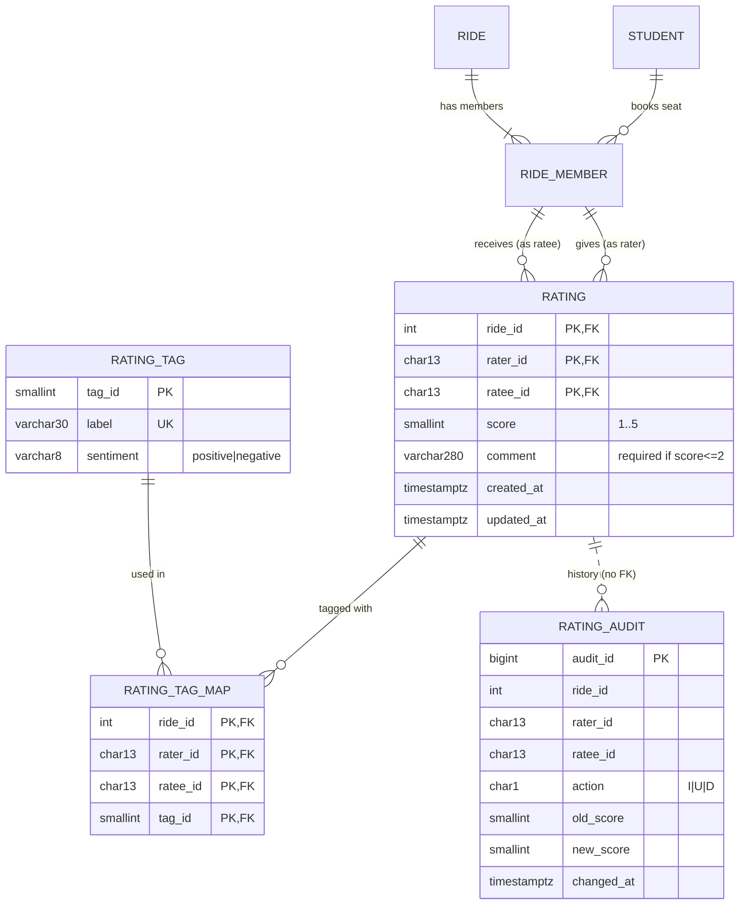

# PoolUp: Ratings + Analytics/Dashboard module, database design

> **Module deep-dive, written by Member 5 while building the module on its own.** In the integrated repository the files are numbered by layer (`db/1x` tables, `2x` logic, `3x` views, `4x` indexes, `db/queries/` named queries) and the references below have been updated to those names. Stand-in tables and the temporary `X-Student-Id` header mentioned in some passages were replaced at integration by the real tables and by Member 1's login; see `../INTEGRATION_NOTES.md`.


**Owner:** Member 5 (Ratings + Analytics / Dashboard)
**DBMS:** PostgreSQL 16 · **Files:** `db/10_ratings_schema.sql`, `db/15_rating_tags.sql`, `db/20_ratings_logic.sql`, `db/30_analytics_views.sql`, `db/40_indexes.sql`, `db/50_analytics_queries.sql`

This document is written so it can be pasted into the team's 5-page design PDF (the module's section), and so that any team member can answer viva questions about this part.

---

## 1. Requirements analysis

### 1.1 Problem
After a pooled cab ride, co-riders have no structured way to signal who was punctual, paid their share and behaved well. Without that signal, students can't tell whether a stranger is a reliable co-rider. The campus also has no visibility into *when*, *where* and *how efficiently* students pool.

### 1.2 Users
| User | What they do in this module |
|---|---|
| **Rider (student)** | Rates co-riders after a completed ride; edits or withdraws a rating within 24 h; views their own reputation and trust network; browses others' profiles |
| **Admin / evaluator** | Views the campus dashboard, leaderboard, audit trail and reliability watchlist |

### 1.3 Functionality
1. List **pending ratings**: co-riders on completed rides not yet rated, inside the 7-day window.
2. **Rate all co-riders of a ride in one transaction** (score, up to 3 tags, comment).
3. **Edit / withdraw** own rating within 24 h; every change is **audited**.
4. **Reputation**: Bayesian average, no-show rate and a 0–100 **trust score**; campus **leaderboard**.
5. **Trust network**: students reachable through chains of strong (≥ 4.5★) ratings.
6. **Campus analytics dashboard**: KPIs, monthly trend, demand heatmap, route economics, occupancy, rating distribution, tag analysis, hostel league, reliability watchlist, ride buddies, rater bias.

### 1.4 Assumptions
- A1: ratings are **directional**: A→B and B→A are different ratings.
- A2: a student who **no-showed** or **cancelled** did not travel, so they can neither rate nor be rated for that ride. No-shows are tracked separately (`ride_member.status`) and feed the trust score.
- A3: ratings are **per ride**, so the same pair can rate each other again on a later ride.
- A4: tags come from a **fixed vocabulary** (13 tags) so they can be aggregated reliably.
- A5: time windows are fixed: **7 days** to rate, **24 hours** to edit or withdraw (single source of truth: `fn_rating_window()` and `fn_edit_window()`).

### 1.5 Business rules and where each is enforced

| ID | Rule | Enforced by | Object |
|---|---|---|---|
| BR1 | Score is an integer 1–5 | CHECK | `rating_score_range` |
| BR2 | Nobody rates themself | CHECK | `rating_no_self` |
| BR3 | Rater **and** ratee were members of *that* ride | **Composite FOREIGN KEY** ×2 | `rating_rater_on_ride`, `rating_ratee_on_ride` |
| BR4 | One rating per (ride, rater, ratee) | PRIMARY KEY | `rating_pk` |
| BR5 | 1★/2★ ratings need a comment ≥ 10 chars | CHECK | `rating_low_needs_comment` |
| BR6 | Tags come from the vocabulary | FOREIGN KEY | `rating_tag_map_tag_fk` |
| BR7 | Each tag at most once per rating | PRIMARY KEY | `rating_tag_map_pk` |
| BR8 | Rate only after the ride is `completed` | BEFORE INSERT trigger | `rule_ride_completed` |
| BR9 | Both people actually travelled (`confirmed`) | BEFORE INSERT trigger | `rule_both_travelled` |
| BR10 | Rate within 7 days of completion | BEFORE INSERT trigger | `rule_rating_window` |
| BR11 | Edit / withdraw only within 24 h | BEFORE UPDATE / DELETE triggers | `rule_edit_window` |
| BR12 | A rating's key (ride, rater, ratee, created_at) is immutable | BEFORE UPDATE trigger | `rule_rating_key_immutable` |
| BR13 | At most 3 tags per rating | BEFORE INSERT trigger on tag map (with row lock) | `rule_max_tags` |
| BR14 | No negative tag on 5★, no positive tag on 1★ | trigger on tag map + on score update | `rule_tag_sentiment` |
| BR15 | A rated ride can't stop being `completed`; a rated rider can't be re-labelled cancelled / no-show | BEFORE UPDATE triggers on `ride`, `ride_member` | `rule_rated_ride_locked`, `rule_rated_member_locked` |
| BR16 | Every insert/update/delete of a rating is logged | AFTER trigger → `rating_audit` | `rating_audit_trg` |

**Design principle:** a rule that can be checked on **one row** is a **declarative constraint** (BR1–BR7). A rule that needs **another table or the clock** is a **trigger** (BR8–BR16). The API never re-implements these rules; it only translates the database's error (SQLSTATE + constraint name) into a readable message.

---

## 2. ER / EER model



### Modelling decisions (and why)

| Construct | Decision | Justification |
|---|---|---|
| **RATING as a relationship** | Conceptually a *ternary* relationship between RIDE, STUDENT (rater) and STUDENT (ratee), i.e. a **recursive** relationship on STUDENT qualified by RIDE. | A rating only makes sense *for a ride*: the same pair can meet on many rides. |
| **Aggregation** | RATING relates two **RIDE_MEMBER** instances (the M:N relationship between STUDENT and RIDE is treated as an entity: EER aggregation). | This is what lets BR3 become a foreign key: rater and ratee must each be an existing (ride, student) membership, not just any student. |
| **Weak entity** | RATING_TAG_MAP has no identity of its own: its key is the owner rating's key + `tag_id`, and it is deleted with its owner (`ON DELETE CASCADE`). | Tags are a **multivalued attribute** of RATING; 1NF forbids storing them as a list, so they get their own relation. |
| **Participation** | RATING → RIDE_MEMBER is **total** for both roles (every rating must have a rater-membership and a ratee-membership); RIDE_MEMBER → RATING is **partial** (most memberships have zero or few ratings). | |
| **Cardinality** | RIDE_MEMBER (rater) 1 : N RATING; RIDE_MEMBER (ratee) 1 : N RATING; RATING M : N RATING_TAG (via map, max 3 per rating). | |
| **Audit as a separate entity** | RATING_AUDIT deliberately has **no foreign key** to RATING. | An audit row must outlive the rating it describes (withdrawn ratings must still be traceable). |
| **Derived attributes** | Bayesian score, trust score, no-show rate, rank: **not stored** in base tables; computed in views. | Storing them would create update anomalies; the materialized view is an explicit, refreshable cache (§5). |

---

## 3. Relational schema

Keys: <u>underline</u> = primary key, *italic* = foreign key.

```
RATING_TAG     (tag_id, label UNIQUE, sentiment)
RATING         (ride_id*, rater_id*, ratee_id*, score, comment, created_at, updated_at)
                 PK (ride_id, rater_id, ratee_id)
                 FK (ride_id, rater_id) → RIDE_MEMBER(ride_id, student_id)
                 FK (ride_id, ratee_id) → RIDE_MEMBER(ride_id, student_id)
RATING_TAG_MAP (ride_id*, rater_id*, ratee_id*, tag_id*)
                 PK (ride_id, rater_id, ratee_id, tag_id)
                 FK (ride_id, rater_id, ratee_id) → RATING  ON DELETE CASCADE
                 FK (tag_id) → RATING_TAG
RATING_AUDIT   (audit_id, ride_id, rater_id, ratee_id, action, old_score, new_score,
                old_comment, new_comment, changed_at, db_user)
```

### Domains and data types

| Column | Type | Why |
|---|---|---|
| `student_id` | `CHAR(13)` + regex CHECK | BITS IDs are fixed-length (`2023A7PS0123H`) |
| `score` | `SMALLINT` + CHECK 1..5 | Integer stars; `SMALLINT` is 2 bytes; text like `'3.5'` is rejected by type checking (SQLSTATE 22P02) |
| `comment` | `VARCHAR(280)` | Tweet-length bound |
| `created_at` / `updated_at` | `TIMESTAMPTZ` | Time-zone-safe; windows compare instants, display is IST |
| `sentiment` | `VARCHAR(8)` + CHECK IN (…) | Enumerated domain |
| `action` | `CHAR(1)` + CHECK IN ('I','U','D') | Compact enum |
| `audit_id` | `BIGSERIAL` | Append-only, grows forever |

### Other constraints on this module's tables (17 total)
`rating_comment_not_blank`, `rating_updated_after_created`, `rating_audit_shape` (I ⇒ only new values, D ⇒ only old values, U ⇒ both), `rating_audit_action`, `rating_tag_sentiment_enum`, `rating_tag_label_unique`, plus the PK/FK/CHECKs listed in §1.5.

---

## 4. Normalization

### Functional dependencies

| Relation | Non-trivial FDs | Candidate keys |
|---|---|---|
| RATING_TAG | tag_id → label, sentiment · label → tag_id, sentiment | {tag_id}, {label} |
| RATING | (ride_id, rater_id, ratee_id) → score, comment, created_at, updated_at | {ride_id, rater_id, ratee_id} |
| RATING_TAG_MAP | none (all-key relation) | {ride_id, rater_id, ratee_id, tag_id} |
| RATING_AUDIT | audit_id → all other attributes | {audit_id} |

### Proof that every relation is in BCNF
- **1NF**: all attributes are atomic. Tags, which are multivalued, were moved to RATING_TAG_MAP instead of a comma list or array column.
- **2NF**: in RATING, no non-key attribute depends on part of the key. `score` needs *all three* of ride, rater and ratee: the same rater gives different scores to different ratees on the same ride, and to the same ratee on different rides.
- **3NF / BCNF**: in every relation, the left side of every non-trivial FD is a superkey. In RATING_TAG, `label → sentiment` is fine because `label` is itself a candidate key.

### What we deliberately did *not* store (redundancy avoided)
| Tempting column | Why not |
|---|---|
| `rating.ratee_name`, `rating.route` | Transitively dependent via `student` / `ride`, so they would cause update anomalies. They are joined in at query time. |
| `student.avg_rating`, `student.trust_score` | Derived. If stored, every rating insert/update/delete would need to maintain them. They are computed in `v_student_reputation` instead. |
| `rating.tags TEXT[]` | Violates 1NF, can't be FK-checked against the vocabulary, and is slow to aggregate. |

### The one controlled redundancy
`mv_student_reputation` (a **materialized view**) stores derived reputation data. This is a conscious, read-performance denormalization. It is safe because it is never written by the application, only regenerated from base tables (`REFRESH MATERIALIZED VIEW CONCURRENTLY`), and the UI shows how stale it is (`mv_staleness` query).

---

## 5. DBMS features used (and the job each one does)

| Feature | Object(s) | Purpose |
|---|---|---|
| **Transactions** | `POST /api/ratings/batch` (`BEGIN … COMMIT/ROLLBACK`); `fn_submit_rating` is atomic | Rating 3 co-riders is all-or-nothing |
| **Triggers** (7) | `rating_before_insert`, `rating_before_update`, `rating_before_delete`, `rating_audit_trg`, `rating_tag_guard`, `ride_protect_rated`, `ride_member_protect_rated` | Cross-table & time-based rules (BR8–BR15), audit (BR16) |
| **Stored functions** (9) | `fn_submit_rating`, `fn_update_rating`, `fn_pending_ratings`, `fn_trust_network`, `fn_bayesian_score`, `fn_trust_score`, `fn_rating_window`, `fn_edit_window`, `fn_refresh_reputation` | Encapsulate multi-statement operations and reusable maths |
| **Views** (3) | `v_ride_summary`, `v_student_activity`, `v_student_reputation` | Reusable derived data; no stored redundancy |
| **Materialized view** | `mv_student_reputation` + UNIQUE index | Fast leaderboard; refreshed concurrently |
| **Indexes** (8 + 2 on MV) | `rating_ratee_idx`, `rating_rater_time_idx`, `ride_member_student_idx`, `ride_completed_idx` (**partial**), `ride_dest_time_idx`, `expense_ride_idx`, `rating_tag_map_tag_idx`, `rating_audit_key_idx` | Each one serves a named query (verify with EXPLAIN in the UI) |
| **Row locking** | `SELECT … FOR UPDATE` in `trg_rating_tag_guard` | Two concurrent tag inserts cannot both pass the "max 3" check |
| **Recursive CTE** | `fn_trust_network` | Graph traversal with cycle prevention |
| **Window functions** | RANK, DENSE_RANK, PERCENT_RANK, LAG, SUM OVER | Rankings, month-on-month change, running totals |

### Why each index exists

| Index | Query that needs it | Without it |
|---|---|---|
| `rating (ratee_id, score)` | profile, reputation, trust network | PK leads with `ride_id`, so "ratings received by X" would scan all ratings |
| `rating (rater_id, created_at DESC)` | "ratings I've given", newest first; rater bias | Full scan + sort |
| `ride_member (student_id, status)` | pending ratings, activity, buddies | PK leads with `ride_id`, so "rides of student X" would be a full scan |
| `ride (completed_at) WHERE status='completed'` | pending ratings (completed in last 7 days), trends | Partial index: smaller because cancelled/open rides are never rated |
| `ride (dest_id, depart_start)` | route analytics; Member 1's ride search | |
| `expense (ride_id)` | fare totals in `v_ride_summary` | PostgreSQL does **not** auto-index FK columns |

---

## 6. Non-trivial queries (all in `db/50_analytics_queries.sql`)

| # | Query | Concepts |
|---|---|---|
| Q1 | `monthly_trend` | `date_trunc` grouping, two CTEs joined, `SUM() OVER` running total, `LAG()` month-on-month % |
| Q2 | `top_routes_by_weekday` | `RANK() OVER (PARTITION BY dow …)`, filter on a window result via CTE |
| Q3 | `no_show_watchlist` | **Correlated subquery** (compares each student with *their own hostel's* average) |
| Q4 | `ride_buddies` | **Self-join** of `ride_member` (`a.student_id < b.student_id` removes mirrored pairs), HAVING, composite-key LEFT JOINs |
| Q5 | `rater_bias` | Correlated subquery per row inside a CTE, then GROUP BY/HAVING, CASE |
| Q6 | `trust_network` | **WITH RECURSIVE**, path arrays for cycle prevention, `DISTINCT ON` for shortest path |
| Q7 | `leaderboard` | Materialized view, `DENSE_RANK` vs `RANK`, parameterised filters |
| Q8 | `kpi_overview` | CTE over a view, aggregate `FILTER`, scalar subqueries, derived metrics |
| Q9 | `pending_ratings` | Anti-join with `NOT EXISTS`, time-window predicate |
| Q10 | `rating_distribution` | `generate_series` LEFT JOIN (shows empty buckets), `SUM(COUNT(*)) OVER ()` |

Plus 14 more (heatmap, route economics, occupancy, tags, hostel league, MV staleness, audit, profile queries…): 24 in total, all served with their SQL and EXPLAIN plan in the UI.

---

## 7. Application workflows (maps to the evaluation rubric)

| Rubric workflow type | This module's workflow | Where |
|---|---|---|
| Transaction / coordinated change across relations | **Rate all co-riders of a ride**: N × (`rating` + `rating_tag_map`) + N `rating_audit` rows in one transaction; any failure rolls back everything | `/rate` page → `POST /api/ratings/batch` |
| Complex retrieval / aggregation / reporting | **Campus dashboard + leaderboard + profile** (24 named queries, views, MV, recursive CTE) | `/dashboard`, `/leaderboard`, `/profile/:id` |
| Integrity / constraint enforcement | **Integrity Lab**: 14 live scenarios, each fired at the DB inside `BEGIN … ROLLBACK`, showing the exact constraint/trigger that rejects it | `/lab` |
